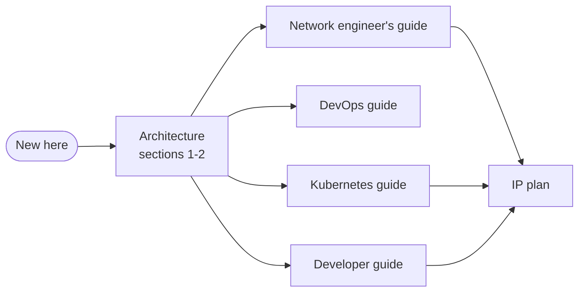

# Documentation

| Document | Read it if you… |
|---|---|
| [Architecture](architecture.md) | want the whole design: fabric, routing, VRF handoff, Kubernetes, traffic, telemetry, IaC, GitOps, design decisions, known gaps |
| [IP plan](ip-plan.md) | need an address, an AS number, or a free VIP |
| [Network engineer's guide](network-engineer-guide.md) | change VLANs, VRFs, routing, policy, switches, links or the WAN |
| [DevOps guide](devops-guide.md) | run the lab: host, build/deploy/destroy, CI/CD, Elastic export, traffic and faults, troubleshooting |
| [Kubernetes guide](kubernetes-guide.md) | operate the cluster platform: nodes, Cilium, BGP, VIP pools, upgrades, failover drills |
| [Developer guide](developer-guide.md) | deploy an app on the cluster and expose it |

Also: [`kubernetes/README.md`](../kubernetes/README.md) (the Kubernetes folder at a glance),
[`containerlab/README.md`](../containerlab/README.md) (running the bundle on any containerlab host).

## Reading paths

The diagrams are Mermaid. GitHub renders them, and so does VS Code with a Mermaid preview extension.
