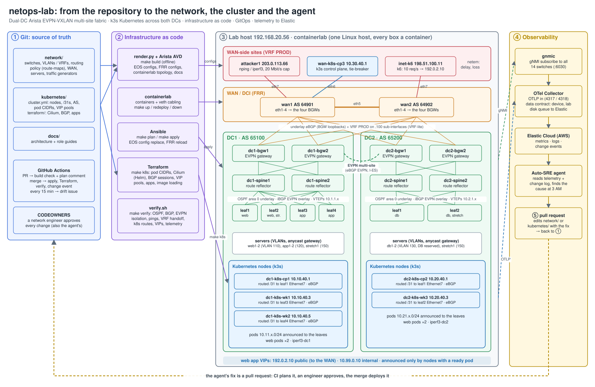
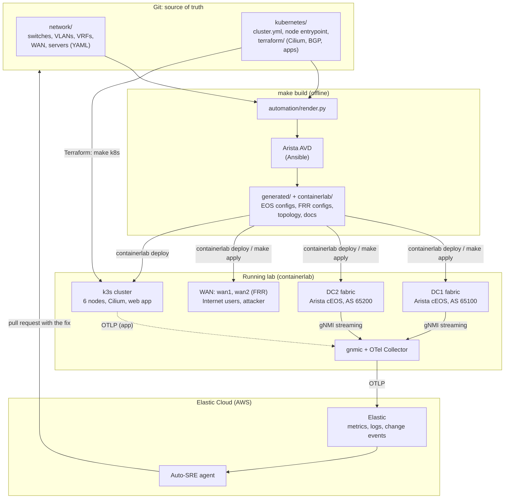
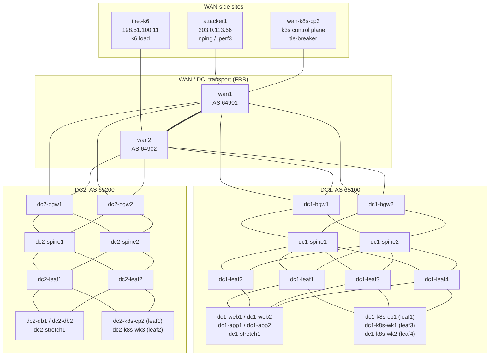
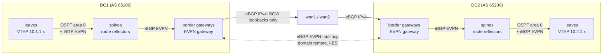
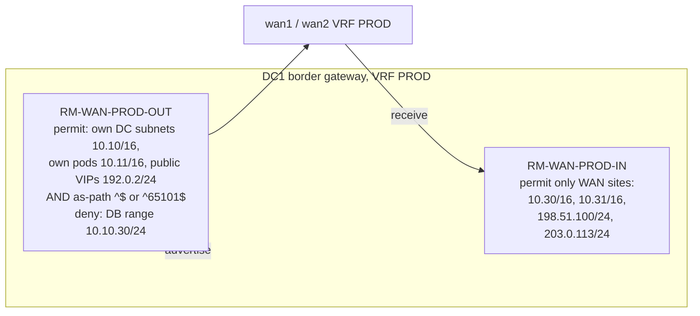
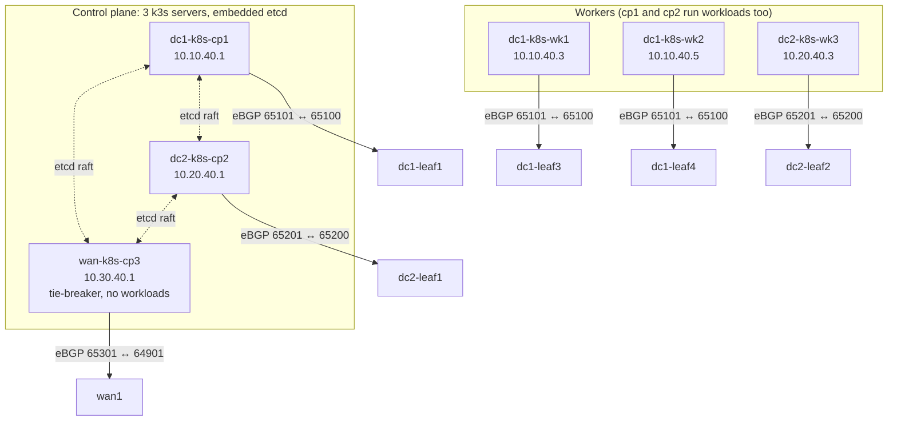
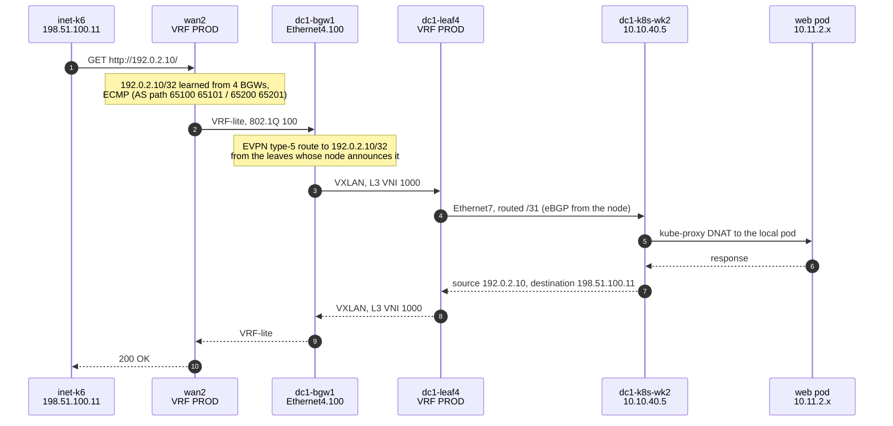
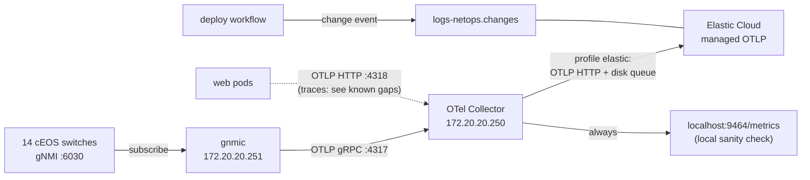
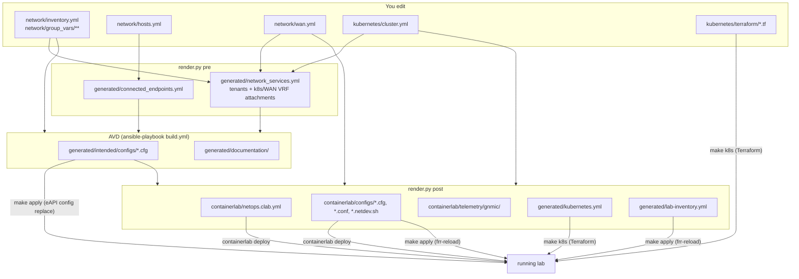
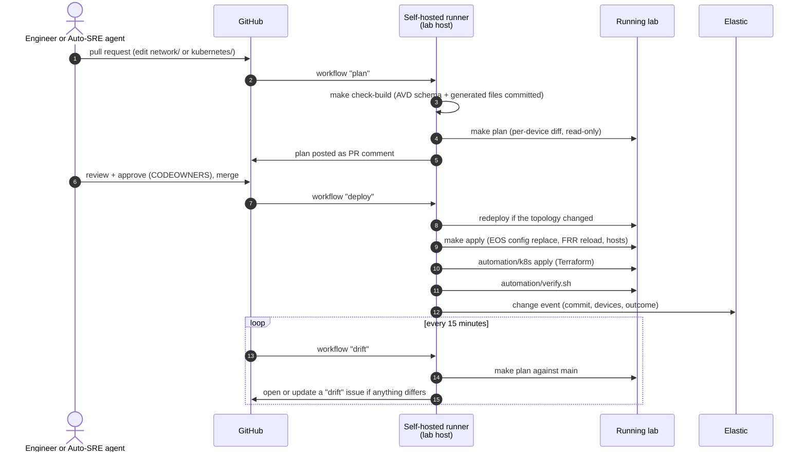

# Architecture

This is the design of the whole lab, from the switch fabric up: the network, the Kubernetes cluster on top
of it, the traffic that runs through it, how telemetry leaves it, and how infrastructure-as-code and
GitOps keep all of it in sync with this repository.

| Section | What it covers |
|---|---|
| [1. The big picture](#1-the-big-picture) | every layer on one page |
| [2. Physical topology](#2-physical-topology) | nodes and cabling |
| [3. Routing design](#3-routing-design) | OSPF underlay, iBGP EVPN overlay, multi-site gateways, WAN |
| [4. Tenant VRF PROD and the WAN handoff](#4-tenant-vrf-prod-and-the-wan-handoff) | VLANs, VNIs, VRF-lite to the WAN, route policy |
| [5. Kubernetes on the fabric](#5-kubernetes-on-the-fabric) | k3s nodes, Cilium, BGP to the leaves, load balancers |
| [6. A request end to end](#6-a-request-end-to-end) | packet walk: Internet user → VIP → pod |
| [7. Traffic generators](#7-traffic-generators) | k6, attacker, iperf3 |
| [8. Telemetry](#8-telemetry) | gNMI → OpenTelemetry → Elastic |
| [9. Infrastructure as code](#9-infrastructure-as-code) | which tool owns what, the build pipeline |
| [10. GitOps](#10-gitops) | PR → plan → merge → deploy → verify |
| [11. Design decisions](#11-design-decisions) | why it is built this way |
| [12. Known gaps](#12-known-gaps) | what is not done yet |

Addresses and AS numbers are collected in [ip-plan.md](ip-plan.md).

---

## 1. The big picture

The same flow, as tool → output:

Four layers, each owned by one tool:

| Layer | What | Owned by |
|---|---|---|
| Network | 14 Arista cEOS switches in two EVPN-VXLAN data centres, 2 FRR WAN routers | `network/` → AVD + `render.py` → containerlab, `make apply` |
| Compute | k3s Kubernetes cluster, nodes plugged into leaves like servers | `kubernetes/cluster.yml` → `render.py` → containerlab |
| Platform and apps | Cilium (pod network, BGP, load balancers), the web app, test servers | `kubernetes/terraform/` → Terraform |
| Observability | gNMI from every switch to an OTel Collector, exported to Elastic | `automation/telemetry/`, `containerlab/telemetry/` |

---

## 2. Physical topology

Every box is a container on one Linux host. Links are veth pairs created by containerlab; the switch
side of each link is a real EOS `EthernetN` interface.

| Port convention | |
|---|---|
| Leaf / BGW `Ethernet1-2` | uplinks to spine1, spine2 |
| Spine `Ethernet1-8` | downlinks to leaves and BGWs |
| BGW `Ethernet3` / `Ethernet4` | to wan1 / wan2 (underlay); `Ethernet3.100` / `Ethernet4.100` = VRF PROD |
| Leaf `Ethernet5-6` | servers (VLAN access ports) |
| Leaf `Ethernet7` | Kubernetes node (routed /31 in VRF PROD) |
| WAN `eth1-4` | to the four BGWs; `eth5` wan1↔wan2; `eth6` tie-breaker (wan1); `eth7` edge site |
| Every node `eth0` / `Management1` | management network 172.20.20.0/24 (not part of the data plane) |

The live view of this diagram: open `containerlab/netops.clab.yml` in VS Code with the Containerlab
extension (TopoViewer), or run `make graph`.

---

## 3. Routing design

| Layer | Protocol | Details |
|---|---|---|
| Underlay inside a DC | OSPF process 100, area 0 | point-to-point /31 links + Loopback0 (router ID) + Loopback1 (VTEP) |
| Overlay inside a DC | iBGP EVPN, one AS per DC | spines are route reflectors for leaves and BGWs |
| BGW ↔ WAN | eBGP IPv4 | carries only the BGW loopbacks, so the two DCs' gateways can reach each other |
| BGW ↔ remote BGW | eBGP EVPN multihop | EVPN Gateway ("multi-site"): routes are re-originated with next-hop-self |
| Stretched L2 safety | RFC 9014 Interconnect ES | both gateways of a DC share one I-ESI; DF election lets one forward BUM per VLAN |

The result: **every leaf only ever sees VTEPs of its own DC**. DC2's routes arrive at a DC1 leaf with a DC1
gateway as next hop. `make verify` checks this ("Multi-site isolation").

Where it is configured: `network/group_vars/FABRIC/routing.yml` (protocols), `network/group_vars/DC1.yml` /
`DC2.yml` (AS, pools, gateways), `network/group_vars/FABRIC/cabling.yml` (BGW ↔ WAN links),
`network/wan.yml` (WAN routers).

---

## 4. Tenant VRF PROD and the WAN handoff

One tenant VRF, `PROD` (L3 VNI 1000), spans both DCs. VLANs are L2 VNIs `10000 + VLAN`.

| VLAN | Name | Subnet / anycast gateway | Where |
|---|---|---|---|
| 110 | WEB | 10.10.10.1/24 | DC1 leaf1, leaf2 |
| 120 | APP | 10.10.20.1/24 | DC1 leaf3, leaf4 |
| 130 | DB | 10.20.30.1/24 | DC2 leaf1, leaf2 (reserved for the database) |
| 150 | STRETCH | 10.15.0.1/24 | DC1 leaf2 + DC2 leaf2, stretched across DCs |

Besides VLANs, VRF PROD has **routed attachments** generated from other source files:

- **Kubernetes nodes:** each one is a routed `/31` on a leaf's `Ethernet7`, with an eBGP session in VRF PROD
  (from `kubernetes/cluster.yml`).
- **The WAN handoff (VRF-lite):** every BGW ↔ WAN link carries an 802.1Q sub-interface `.100` in VRF PROD
  with an eBGP session. The WAN routers have a matching Linux VRF `PROD`. This is how WAN-side sites (the
  Kubernetes tie-breaker, Internet users, the attacker) reach the DCs.

Because DC2 prefixes are now reachable two ways from DC1 (EVPN through the gateways, or VRF-lite through
the WAN), route policy on the BGWs decides:

- A DC only hands the WAN **its own** prefixes (the AS-path check stops DC1 re-advertising DC2's routes).
  DC1 ↔ DC2 traffic therefore always stays on EVPN.
- **Internal VIPs (10.99.0.0/24) and the database range never leave the DCs.** Only public VIPs do.
- Leaves accept from a Kubernetes node only its pod /24 and /32 VIPs (`RM-K8S-IN`) and send it nothing
  (`RM-K8S-OUT`; nodes use a static route to the leaf).

The route-maps are readable YAML in `network/group_vars/DC1.yml` / `DC2.yml` (`structured_config`), so a
bad policy change is a reviewable diff, and so is the fix.

---

## 5. Kubernetes on the fabric

| Piece | Design |
|---|---|
| Distribution | k3s v1.36 (single binary), each node a containerlab node |
| Node networking | `eth1` = routed /31 to its switch; the node IP is pinned to it (`--node-ip`), so all node-to-node and pod traffic crosses the fabric. `eth0` (management) is only for image pulls and telemetry |
| Control plane | 3 servers: one per DC plus a tie-breaker on the WAN. Losing a whole DC still leaves 2 of 3 etcd members |
| Pod network | Cilium, **native routing** (no overlay inside the fabric's VXLAN). Each node owns a fixed pod /24 and announces it to its switch over eBGP |
| Pod CIDRs | per node, from `cluster.yml`: DC1 `10.11.x.0/24`, DC2 `10.21.x.0/24`, WAN `10.31.0.0/24`. Set by Terraform; k3s's own allocation is off |
| Services | ClusterIP range 10.43.0.0/16 (cluster-internal, not routed); kube-proxy forwards |
| Load balancers | Cilium LB IPAM hands out VIPs from two pools; Cilium BGP announces each VIP as a /32 **only from nodes with a ready endpoint** (`externalTrafficPolicy: Local`) |
| VIP pools | `internal` 10.99.0.0/24 (inside the DCs only), `public` 192.0.2.0/24 (also to the WAN; only for services labelled `netops.lab/exposure=public`) |

Failover is plain BGP: if every web pod in DC1 dies, DC1's nodes withdraw the VIP, the DC1 leaves and
gateways lose the route, and the WAN only sees DC2's path.

What runs in the cluster today (namespace `prod`):

| Workload | Exposure |
|---|---|
| `web`: the colleague's app `chaos2cure/web:1`, 4 replicas spread 2 + 2 over the DCs | `web-public` 192.0.2.10:80, `web-internal` 10.99.0.10:80 |
| `iperf3-dc1`, `iperf3-dc2`: one iperf3 server per DC | ClusterIP `iperf3-dc1.prod`, `iperf3-dc2.prod` port 5201 |
| `db`: reserved Service, no backend yet | `db.prod` 5432, future backend VIP 10.20.30.10 |

---

## 6. A request end to end

Every hop on this path has a unique, routed IP address, and every switch on it streams interface
counters and BGP state, so a problem at any hop is visible in the telemetry.

---

## 7. Traffic generators

| Generator | Where | Default behaviour | Configured in |
|---|---|---|---|
| k6 | `inet-k6` behind wan2, 198.51.100.11 | always on: 5 iterations/s to `http://192.0.2.10`, each `GET /` + `GET /api/products` (10 req/s) | `network/wan.yml` (`TARGET`, `RPS`), `containerlab/static/generators/baseline.js` |
| nping, iperf3, curl, mtr | `attacker1` behind wan1, 203.0.113.66 | idle; run on demand. Uplink capped at 20 Mbit/s by `tc`; no Internet egress | `network/wan.yml` (`rate_limit`) |
| iperf3 servers | pods `iperf3-dc1`, `iperf3-dc2` | listening; drive DC1 ↔ DC2 load across the DCI | `kubernetes/terraform/apps.tf` |
| fault injection | any link | `automation/lab netem …` (containerlab netem: delay, loss, jitter, rate) | — |

Examples are in the [DevOps guide](devops-guide.md#traffic-and-faults).

---

## 8. Telemetry

The full reference (data model, operating, gaps, roadmap) is the [streaming telemetry guide](telemetry.md).

| Subscription | Paths | Mode |
|---|---|---|
| `if-counters` | `/interfaces/interface/state/counters` | sample 10 s |
| `if-state` | `/interfaces/interface/state/oper-status` (UP = 1) | on change |
| `bgp-state` | BGP neighbor `session-state` (IDLE 1 … ESTABLISHED 6) | on change |
| `bgp-prefixes` | BGP neighbor AFI/SAFI prefix counts | sample 30 s |
| `platform` | CPU utilisation, memory | sample 30 s |
| `lldp` | neighbor system name and port | on change |

- **Metric names** are prefixed `gnmi_`. Every series has the resource attributes `source` / `device`,
  `site`, `role`, `vendor`, `lab=netops`.
- Interface series for unused ports are dropped at gnmic, using a per-device filter generated by `make build`.
- **Export to Elastic** happens when `automation/elastic.env` (git-ignored) holds `ELASTIC_OTLP_ENDPOINT`
  and `ELASTIC_API_KEY`. `make up` / `make redeploy` then start the collector with the `elastic` profile.
- **Change events:** every deploy records one (commit, author, changed devices, outcome) to
  `~/netops-changes.jsonl` and, when configured, to Elastic `logs-netops.changes`. The agent can then line
  up "what changed" with "when symptoms started".

---

## 9. Infrastructure as code

| Tool | Owns | Why this tool |
|---|---|---|
| **Arista AVD** | EOS configs for all 14 switches, fabric docs | vendor-maintained EVPN design engine with schema validation |
| **render.py** | glue: AVD inputs from `hosts.yml` / `cluster.yml` / `wan.yml`, FRR configs, the containerlab topology, gnmic targets, Terraform input | one place that derives every cross-tool fact (a node's /31 appears on the leaf, in the topology and in Terraform from one line) |
| **containerlab** | containers and veth cabling | the only tool that can wire links into cEOS; Terraform has no provider for it |
| **Ansible** | `make plan` / `make apply` to running devices | eAPI config-replace for EOS, `frr-reload` for FRR, idempotent host addressing |
| **Terraform** | everything inside Kubernetes: pod CIDRs, Cilium (Helm), BGP and LB pools (CRDs), apps, image loading | declarative state, plan/apply, providers for Kubernetes and Helm |

Build rules:
- `generated/` and `containerlab/` are **committed outputs**. CI fails a PR if they differ from a fresh `make build`.
- `make build` is offline and touches no device.
- Terraform state lives with the running lab (`~/clab-runs/clab-netops/terraform-kubernetes.tfstate`), so
  it is discarded with `make down` and a fresh lab gets a fresh state.

---

## 10. GitOps

Workflows live in `.github/workflows/` (`plan.yml`, `deploy.yml`, `drift.yml`) and run on a self-hosted
runner labelled `netops-lab` on the lab host. Secrets: `EOS_USER`, `EOS_PASSWORD` (set);
`ELASTIC_ES_URL`, `ELASTIC_API_KEY` (optional, not set yet, so change events stay in `~/netops-changes.jsonl`).

---

## 11. Design decisions

| Decision | Alternatives | Why |
|---|---|---|
| All-Arista fabric with AVD | multi-vendor (SR Linux + cEOS) | one well-supported EVPN design engine; configs are generated, not hand-written |
| OSPF underlay + iBGP EVPN, one AS per DC | eBGP underlay | simpler per-DC AS story for humans and the agent; route reflectors on spines |
| EVPN Gateway (multi-site) with I-ES | flat EVPN across the WAN | leaves see only local VTEPs; failure domains stay per DC; stretched L2 is loop-safe |
| VRF-lite handoff to the WAN | extend EVPN to the WAN routers | FRR WAN stays simple; route policy is explicit and testable at one place (BGWs) |
| k3s in containerlab | kind, k3d, VMs | lightest real Kubernetes; nodes cable into leaves exactly like servers |
| Cilium native routing + BGP | flannel VXLAN + MetalLB | no VXLAN-in-VXLAN; pod IPs are real fabric routes, so flows and probes see pods |
| 3 control-plane nodes incl. a WAN tie-breaker | 2 + 1 in the DCs | either DC can fail without losing etcd quorum |
| `externalTrafficPolicy: Local` | Cluster | the VIP follows healthy pods; DC failover is visible in BGP |
| Terraform for in-cluster objects | Helm CLI / kubectl apply / k3s auto-deploy | user requirement: Terraform wherever possible; plan/apply and state |
| Single gnmic, no clustering | gnmic cluster + Consul | one host, so clustering added churn without adding resilience |
| linux nodes `restart-policy: "no"` | containerlab 0.80 default `always` | a Docker restart creates a new network namespace and silently drops the node's links |

---

## 12. Known gaps

| Gap | Impact | Next step |
|---|---|---|
| Elastic endpoint and API key not configured yet | telemetry stays in the lab (`localhost:9464/metrics`); a CI redeploy also comes back without Elastic | `automation/elastic.env` + repository secrets: [observability roadmap](observability-roadmap.md) steps 0–2 |
| OTel Collector has a metrics pipeline only | the web app's trace export fails with HTTP 404 (seen in the pod logs) | add `traces` and `logs` pipelines: [roadmap](observability-roadmap.md) step 1 |
| No routing-table telemetry | OpenConfig AFT and BGP RIB paths return empty (only `provider eos-native` is enabled) | enable `provider aft`: [roadmap](observability-roadmap.md) steps 5–6 |
| No Kubernetes, Cilium or Hubble telemetry | node, pod and Cilium health not visible | [roadmap](observability-roadmap.md) steps 11–12 |
| No flow data (cEOS sends no sFlow samples) | no per-flow reachability analysis yet | host-side sampling (pmacctd / hsflowd) → Elastic: [roadmap](observability-roadmap.md) step 10 |
| No synthetic ping-mesh | reachability only via `make verify` | `icmp_check` probes → OTLP (designed, not built) |
| WAN routers hash ECMP on L3 only | one client (k6) always lands in the same DC | `net.ipv4.fib_multipath_hash_policy=1` on wan1/wan2 |
| Occasional VIP request timeouts were seen once | not reproduced on re-test (40/40 OK) | watch `make verify`; investigate if it recurs |
| Repo is public and the runner is self-hosted | a fork PR could run code on the lab host | mitigated: workflows from fork PRs need approval; keep it that way (or make the repo private) |
