# Cilium

Cilium is the Kubernetes network layer of the lab. It has four jobs:

- **pod networking**: native routing, so pod IPs are real fabric addresses;
- **BGP to the leaves**: each node announces its pod /24 and its load-balancer VIPs;
- **load-balancer IP management (LB IPAM)**: VIPs from two pools;
- **Hubble**: flow visibility on every node.

This page covers how it is configured, how packets move, and how to operate and troubleshoot it. For the
cluster as a whole see the [Kubernetes guide](kubernetes-guide.md); for the design reasoning see
[architecture §5](architecture.md#5-kubernetes-on-the-fabric).

All output below comes from the running lab (Cilium 1.20.2 on k3s v1.36.5, 2026-10-11).

---

## 1. At a glance

| Item | Value |
|---|---|
| Version | 1.20.2 (`cilium_version` in `kubernetes/cluster.yml`) |
| Installed by | Terraform `helm_release.cilium` in `kubernetes/terraform/cilium.tf` (Helm chart from `helm.cilium.io`) |
| Runs as | DaemonSet `cilium` (agent, one per node) + DaemonSet `cilium-envoy` + Deployment `cilium-operator` (1 replica), all in `kube-system` |
| Routing | native: no VXLAN or Geneve tunnel, so there is no VXLAN-in-VXLAN on top of the EVPN fabric |
| IPAM | `kubernetes`: each node's pod /24 comes from `spec.podCIDR`, which Terraform sets from `cluster.yml` |
| Service forwarding | **kube-proxy** (k3s default, iptables). Cilium does *not* replace it (`kubeProxyReplacement: false`) |
| Masquerade | iptables; only for traffic leaving `10.0.0.0/8` |
| BGP | Cilium BGP control plane, one eBGP session per node to the switch on its /31 |
| Load-balancer IPs | Cilium LB IPAM, pools `internal` 10.99.0.0/24 and `public` 192.0.2.0/24 |
| Hubble | on, with a 4,095-flow ring buffer per node. **Relay off, metrics off, nothing exported** |
| Network policy | none defined (policy enforcement stays at the default, so all traffic is allowed) |

## 2. Where it is defined

| File | What |
|---|---|
| `kubernetes/cluster.yml` | `cilium_version`, per-node `asn` / `link` / `pod_cidr` / `switch`, `load_balancer_pools`, `routes_via_fabric` |
| `kubernetes/terraform/cilium.tf` | the Helm release and its values (§3) |
| `kubernetes/terraform/bgp.tf` | the BGP objects and the LB pools (§5, §6) |
| `kubernetes/terraform/nodes.tf` | sets each node's `spec.podCIDR` before Cilium starts |
| `kubernetes/node/entrypoint.sh` | node prerequisites: rshared `/`, a shared bpffs on `/sys/fs/bpf`, the routes for `routes_via_fabric` |
| `network/group_vars/DC1.yml`, `DC2.yml` | the switch side: `PL-K8S-IN`, `RM-K8S-IN`, `RM-K8S-OUT` (§5.3) |
| `network/wan.yml` → FRR | the switch side for the tie-breaker node `wan-k8s-cp3` on wan1 |

Never change Cilium with `helm` or `kubectl edit`. Edit the files above, then `make k8s-plan` and `make k8s`.
Terraform puts back anything changed by hand.

## 3. Helm values explained

```hcl
ipam                  = { mode = "kubernetes" }
routingMode           = "native"
ipv4NativeRoutingCIDR = "10.0.0.0/8"
autoDirectNodeRoutes  = false
enableIPv4Masquerade  = true
kubeProxyReplacement  = false
bgpControlPlane       = { enabled = true }
operator              = { replicas = 1 }
hubble                = { enabled = true, relay = { enabled = false } }
```

| Value | Why |
|---|---|
| `ipam.mode: kubernetes` | Pod /24s are planned per node in `cluster.yml` (so they can be announced and filtered on the leaves). Cilium uses whatever `spec.podCIDR` says rather than inventing its own. |
| `routingMode: native` | Pods get real fabric addresses. The leaves route pod traffic like any other prefix, and flows and probes see pod IPs. |
| `ipv4NativeRoutingCIDR: 10.0.0.0/8` | Destinations inside 10/8 are reachable without NAT: pods, nodes, hosts and VIPs. Pod traffic to them keeps the pod's source IP. |
| `autoDirectNodeRoutes: false` | Nodes are on different /31s, not one L2 segment, so Cilium must not install node-to-node routes. The leaves route between nodes. |
| `enableIPv4Masquerade: true` | New connections from pods to anything outside 10/8 (for example the Internet through management) leave with the node's IP. |
| `kubeProxyReplacement: false` | k3s ships kube-proxy, and keeping it is the smallest change from a stock k3s. kube-proxy does ClusterIP and LoadBalancer forwarding; Cilium only hands out the VIPs and announces them. |
| `bgpControlPlane.enabled` | Turns on the BGP objects in §5. |
| `operator.replicas: 1` | One operator is enough for a lab; it is not on the data path. |
| `hubble.enabled`, relay off | Each agent keeps recent flows in memory. There is no cluster-wide Relay; you query one node at a time (§7). |

Live check of what the agent actually runs with (node `dc1-k8s-wk1`):

```
KubeProxyReplacement:    False
Cilium:                  Ok   1.20.2 (v1.20.2-e0dc92bd)
IPAM:                    IPv4: 2/254 allocated from 10.11.1.0/24,
Routing:                 Network: Native   Host: Legacy
Attach Mode:             TCX
Masquerading:            IPTables [IPv4: Enabled, IPv6: Disabled]
Hubble:                  Ok              Current/Max Flows: 226/4095 (5.52%), Flows/s: 0.63   Metrics: Disabled
Cluster health:          6/6 reachable
```

## 4. How packets move

Each node has two interfaces:

| Interface | Used for |
|---|---|
| `eth1`: routed /31 to its leaf (or wan1) | everything in `routes_via_fabric`: `10.0.0.0/8`, `192.0.2.0/24`, `198.51.100.0/24`, `203.0.113.0/24`. The node IP is pinned here, so node-to-node and pod traffic always crosses the fabric |
| `eth0`: containerlab management | the default route: image pulls and telemetry export only |

Routing table on `dc2-k8s-cp2`:

```
default via 172.20.20.1 dev eth0
10.0.0.0/8 via 10.20.40.0 dev eth1
10.20.40.0/31 dev eth1 proto kernel scope link src 10.20.40.1
10.21.0.0/24 via 10.21.0.193 dev cilium_host proto kernel src 10.21.0.193
192.0.2.0/24 via 10.20.40.0 dev eth1
198.51.100.0/24 via 10.20.40.0 dev eth1
203.0.113.0/24 via 10.20.40.0 dev eth1
```

### 4.1 Pod to pod across the DCs

```mermaid
flowchart LR
  P1["web pod 10.11.0.27<br/>dc1-k8s-cp1"] -- "veth → node routing<br/>10/8 via eth1" --> L11["dc1-leaf1<br/>VRF PROD"]
  L11 -- "EVPN/VXLAN<br/>(L3 VNI 1000)" --> G1["dc1 border gateways"]
  G1 -- "EVPN gateway<br/>over the WAN" --> G2["dc2 border gateways"]
  G2 -- "EVPN/VXLAN" --> L21["dc2-leaf1"]
  L21 -- "10.21.0.0/24<br/>learned over BGP from cp2" --> N2["dc2-k8s-cp2"] --> P2["web pod 10.21.0.79"]
```



No NAT and no tunnel inside the cluster. The source IP stays the pod IP from end to end, so switch
counters, sFlow and app traces all see the same address.

### 4.2 Internet user to a VIP

1. `inet-k6` (198.51.100.11) sends to `192.0.2.10`.
2. wan1/wan2 pick a DC by BGP. Each DC's gateways only have the /32 if a node in that DC announces it.
3. The leaf forwards to a node that announced `192.0.2.10/32`. Only nodes with a ready `web` pod announce it
   (`externalTrafficPolicy: Local`).
4. On the node, **kube-proxy** DNATs the VIP to a *local* web pod. The client IP is preserved; Hubble shows
   it as `198.51.100.11 (world) -> prod/web-…:80 FORWARDED`.
5. The reply goes back the same way.

### 4.3 Pod to the outside

Destinations in 10/8 are routed natively. New connections to anything else are masqueraded to the node IP
and follow the node's routing table: the WAN test ranges via `eth1`, everything else via `eth0`
(management).

## 5. BGP

### 5.1 Objects (all in `bgp.tf`)

| Object | Count | Content |
|---|---|---|
| `CiliumBGPClusterConfig` | one per node, named after the node | selects that node by hostname; BGP instance `fabric` with the node's `localASN` and one peer: its switch's /31 address and AS |
| `CiliumBGPPeerConfig` `fabric` | one | hold time 9 s, keepalive 3 s, graceful restart on, family ipv4/unicast, advertisements with label `netops.lab/advertise=fabric` |
| `CiliumBGPAdvertisement` `fabric` | one | `PodCIDR` (the node's /24) and `Service` → `LoadBalancerIP` for every service *without* the label `netops.lab/no-bgp` |
| `CiliumLoadBalancerIPPool` | two | §6 |

AS numbers: DC1 nodes 65101 (leaves 65100), DC2 nodes 65201 (leaves 65200), the WAN tie-breaker 65301
(wan1 64901).

### 5.2 What a node announces

- **Always:** its pod /24.
- **Only with a ready local endpoint:** the /32 of each LoadBalancer VIP.

So the set changes as pods move. In the current lab both DC1 web pods run on `dc1-k8s-cp1` and both DC2
pods on `dc2-k8s-cp2`, so only those two nodes announce the VIPs:

```
# dc2-k8s-cp2
Instance   Prefix          NextHop   Best
fabric     10.21.0.0/24    0.0.0.0   true
           10.99.0.10/32   0.0.0.0   true
           192.0.2.10/32   0.0.0.0   true

# dc1-k8s-wk1 (no web pod)
Prefix         NextHop      Attrs
10.11.1.0/24   10.10.40.3   [{Origin: i} {AsPath: 65101} {Nexthop: 10.10.40.3}]
```

### 5.3 What the switch accepts and sends

Defined in `network/group_vars/DC1.yml` and `DC2.yml`, so a node can't inject arbitrary routes:

| Policy | Rule |
|---|---|
| `PL-K8S-IN` / `RM-K8S-IN` | accept only the zone's pod /24s (DC1 `10.11.0.0/16`, DC2 `10.21.0.0/16`, exactly /24), `/32`s from `10.99.0.0/24` and `/32`s from `192.0.2.0/24` |
| `RM-K8S-OUT` | deny everything: nodes need no routes from the fabric, they have static routes via `eth1` |

Leaf view:

```
dc1-leaf1# show ip bgp summary vrf PROD
  Description      Neighbor   AS     Up/Down  State  PfxRcd PfxAcc PfxAdv
  k8s dc1-k8s-cp1  10.10.40.1 65101  00:05:01 Estab  3      3      0

dc1-leaf1# show ip route vrf PROD 192.0.2.10
 B E      192.0.2.10/32 [200/0]
           via 10.10.40.1, Ethernet7
```

`PfxAdv 0` is expected (`RM-K8S-OUT`). `PfxRcd 3` = the pod /24 plus the two VIPs.

### 5.4 Failover behaviour

Hold time 9 s: a dead node's routes leave the fabric within about 9 s. Graceful restart keeps a node's
routes while its agent restarts.

When the last ready web pod on a node goes away, the node withdraws the VIP /32s at once. If no node in a
DC has a ready pod, the DC's gateways lose the route and the WAN only sees the other DC. The drill is in
the [Kubernetes guide](kubernetes-guide.md#failover-drill).

## 6. Load-balancer IPs

| Pool | Block | Who may use it | Reaches |
|---|---|---|---|
| `internal` | 10.99.0.0/24 | any LoadBalancer service | inside the DCs only |
| `public` | 192.0.2.0/24 | only services labelled `netops.lab/exposure=public` | also handed to the WAN (`PL-WAN-PROD-OUT`) |

A service asks for a fixed address with the annotation `lbipam.cilium.io/ips` (the web services use
`192.0.2.10` and `10.99.0.10`). To keep a service's VIP out of BGP, label it `netops.lab/no-bgp`.

```
NAME       DISABLED   CONFLICTING   IPS AVAILABLE
internal   false      False         255
public     false      False         255
```

Pools come from `load_balancer_pools` in `cluster.yml`. To change a pool, see
[Kubernetes guide → Change the VIP pools](kubernetes-guide.md#change-the-vip-pools-or-add-a-pool): the
switches must accept the new range too.

## 7. Hubble

Hubble is on in every agent, but **Relay is off**, so there is no `hubble` CLI or UI for the whole cluster.
Each agent keeps its own last 4,095 flows. Query the node you care about:

```bash
# pick the Cilium agent on a node
P=$(automation/k8s kubectl -n kube-system get pods -l k8s-app=cilium \
      --field-selector spec.nodeName=dc2-k8s-cp2 -o name)
H="automation/k8s kubectl -n kube-system exec $P -c cilium-agent -- hubble observe"

$H --last 20 -o compact                      # recent flows on that node
$H --pod prod/ --last 20 -o compact          # flows to/from pods in namespace prod
$H --verdict DROPPED --last 20 -o compact    # drops, with the reason
$H --ip 198.51.100.11 -f                     # follow one client live
```

Example (a WAN user hitting the public VIP, served on `dc2-k8s-cp2`):

```
198.51.100.11:53038 (world) -> prod/web-7877885c56-bqgkp:80 (ID:1710) to-endpoint FORWARDED (TCP Flags: ACK, PSH)
198.51.100.11:53038 (world) <- prod/web-7877885c56-bqgkp:80 (ID:1710) to-stack FORWARDED (TCP Flags: ACK, PSH)
```

`DROPPED (ICMPv6 RouterSolicitation) Unsupported L3 protocol` is normal noise. The lab is IPv4 only, and
pods still send IPv6 router solicitations.

Not yet enabled: Hubble metrics, a flow-log export, and Relay. Shipping Hubble data to Elastic is
[observability roadmap](observability-roadmap.md) Step 12.

## 8. Operating

### Health

```bash
automation/k8s kubectl -n kube-system get pods -o wide | grep cilium     # 6 agents, 6 envoy, 1 operator
automation/k8s kubectl -n kube-system exec ds/cilium -c cilium-agent -- cilium-dbg status
```

`exec ds/cilium` lands on one agent. To check a specific node, pick its pod with
`--field-selector spec.nodeName=<node>` as in §7.

### BGP

```bash
X="automation/k8s kubectl -n kube-system exec ds/cilium -c cilium-agent -- cilium-dbg shell --"
$X bgp/peers           # session state, received / advertised counts
$X bgp/routes          # what this node announces
automation/k8s kubectl get ciliumbgpclusterconfigs,ciliumbgppeerconfigs,ciliumbgpadvertisements
```

`cilium-dbg bgp peers` and `cilium-dbg bgp routes` still work but are deprecated in 1.20. Use the `shell`
form above.

From the fabric: `automation/lab cli dc1-leaf1`, then `show ip bgp summary vrf PROD` and
`show ip route vrf PROD 10.11.0.0/24`.

### Endpoints and IPAM

```bash
automation/k8s kubectl -n kube-system exec $P -c cilium-agent -- cilium-dbg endpoint list
automation/k8s kubectl get ciliumnodes -o custom-columns=NAME:.metadata.name,PODCIDR:.spec.ipam.podCIDRs
```

### Change or upgrade

| Change | How |
|---|---|
| A Helm value | edit `cilium.tf`, `make k8s-plan`, `make k8s` (Helm upgrade in place) |
| Cilium version | bump `cilium_version` in `cluster.yml`, `make build`, `make k8s-plan`, `make k8s` |
| BGP timers, advertisements | `bgp.tf`, then `make k8s` |
| A node's AS, /31 or pod CIDR | `cluster.yml`, `make build`, `make redeploy` (`spec.podCIDR` can only be set once) |

The Helm release waits up to 15 minutes (`timeout = 900`) for every agent to become ready.

## 9. Troubleshooting

| Symptom | Look at | Usual cause / fix |
|---|---|---|
| Cilium pods stuck in `Init:CreateContainerError` | `kubectl -n kube-system describe pod <cilium-…>` | `/sys/fs/bpf ... not a shared mount`: the node entrypoint didn't make `/` rshared and mount bpffs. Fixed in `kubernetes/node/entrypoint.sh`; a node from an old image needs `make redeploy` |
| `make k8s`: `cannot re-use a name that is still in use` | `helm -n kube-system list` shows `cilium` as `failed` | an earlier install timed out outside Terraform state: `terraform import helm_release.cilium kube-system/cilium` ([DevOps guide](devops-guide.md#troubleshooting)) |
| Nodes `NotReady` right after deploy | `cilium-dbg status` | agents still starting; wait, then `make k8s` again |
| BGP session not `established` | `$X bgp/peers` on the node; `show ip bgp summary vrf PROD` on the leaf | AS or address mismatch between `cluster.yml` and the leaf (rebuild with `make build`); or the node's `eth1` is down: never `docker restart` a node, use `make redeploy` |
| Pod /24 missing on the leaf | `$X bgp/routes`; `kubectl get ciliumnodes` | `spec.podCIDR` not set (`nodes.tf`), or the leaf's `PL-K8S-IN` doesn't allow that /24 |
| VIP missing on the leaf | `$X bgp/routes` on a node with a web pod; `kubectl -n prod get pods -o wide` | no *ready* pod on that node (by design with `externalTrafficPolicy: Local`); or the service is missing `netops.lab/exposure=public` for the public pool |
| Service `EXTERNAL-IP` stays `<pending>` | `kubectl get ciliumloadbalancerippools` | pool exhausted or `CONFLICTING`; a public VIP asked for by a service without the `public` label |
| Traffic drops | `hubble observe --verdict DROPPED` on the receiving node | the drop reason is in the flow line |
| Pod can't reach the Internet | node routing table (§4) | expected for anything that isn't routed via `eth0`; check the masquerade line in `cilium-dbg status` |

## 10. Known gaps

| Gap | Next step |
|---|---|
| No Cilium or Hubble metrics, no flow export, no Relay | [observability roadmap](observability-roadmap.md) Step 12 |
| No network policies | add `CiliumNetworkPolicy` objects in Terraform when needed; Hubble then shows `POLICY_DENIED` drops |
| One operator replica | fine for the lab; raise `operator.replicas` for resilience |
| kube-proxy still forwards Services | `kubeProxyReplacement: true` would move it to eBPF; not needed for the lab and it changes how VIP traffic looks in iptables-based troubleshooting |
