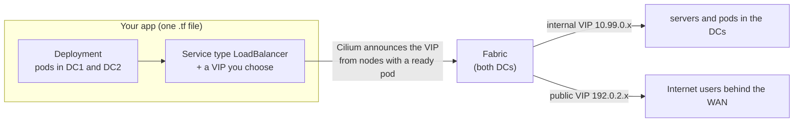

# Developer guide: deploy an app

For people who want to run an application on the lab's Kubernetes cluster and reach it from the DCs or the
"Internet". You describe your app in a Terraform file. A pull request plans it, and a merge deploys it.
You never run `kubectl apply`.

## What the platform gives you



| You get | Details |
|---|---|
| Two data centres | nodes in zones `dc1` and `dc2` (`topology.kubernetes.io/zone`); spread your replicas over both |
| Real, routed pod IPs | DC1 pods `10.11.x.x`, DC2 pods `10.21.x.x`, visible to the network and its telemetry |
| Load balancing with failover | a VIP is announced only by nodes running a **ready** pod of your app; if a DC has none, traffic goes to the other one |
| Two kinds of VIP | internal `10.99.0.0/24` (DCs only) or public `192.0.2.0/24` (also reachable from the WAN / Internet users) |
| In-cluster DNS | `<service>.<namespace>`, e.g. `web-internal.prod`, `iperf3-dc2.prod`; the future database is `db.prod:5432` |
| Telemetry endpoint | OTLP at `http://172.20.20.250:4318` (HTTP) / `:4317` (gRPC); see [Telemetry](#telemetry) |

## Deploy an app in five steps

The example deploys a small echo server on the internal VIP `10.99.0.20`. It was checked with `terraform plan`
against the live cluster (2 resources to add).

### 1. Choose an image

| Image | What to do |
|---|---|
| Public (Docker Hub, ghcr.io, quay.io) | nothing; nodes pull it via the management network |
| Built on the lab host (`docker build -t myteam/myapp:1 .`) | add it to `local_images` in `kubernetes/terraform/nodes.tf`; Terraform copies it into every workload node, and again whenever the image changes. Use `image_pull_policy = "Never"` |

Use a **fixed tag**, never `latest`. A new tag is how Terraform knows to roll out a new version.

### 2. Pick a VIP

Take the next free address from the registry in [ip-plan.md](ip-plan.md#load-balancer-vip-registry) and add
your row there in the same PR.
- **Internal**, `10.99.0.0/24`: other apps and servers in the DCs can reach it.
- **Public**, `192.0.2.0/24`: Internet users (`inet-k6`) can also reach it. Label the service
  `netops.lab/exposure = "public"`; the public pool only serves labelled services.

### 3. Write `kubernetes/terraform/app-<name>.tf`

```hcl
# hello: example app, spread over both DCs, reachable inside the DCs on 10.99.0.20.
resource "kubernetes_deployment_v1" "hello" {
  metadata {
    name      = "hello"
    namespace = kubernetes_namespace_v1.prod.metadata[0].name
    labels = {
      app = "hello"
    }
  }
  spec {
    replicas = 2
    selector {
      match_labels = {
        app = "hello"
      }
    }
    template {
      metadata {
        labels = {
          app = "hello"
        }
      }
      spec {
        affinity {
          node_affinity { # DC zones only (not the WAN tie-breaker)
            required_during_scheduling_ignored_during_execution {
              node_selector_term {
                match_expressions {
                  key      = "topology.kubernetes.io/zone"
                  operator = "In"
                  values   = ["dc1", "dc2"]
                }
              }
            }
          }
        }
        topology_spread_constraint { # one per DC
          max_skew           = 1
          topology_key       = "topology.kubernetes.io/zone"
          when_unsatisfiable = "DoNotSchedule"
          label_selector {
            match_labels = {
              app = "hello"
            }
          }
        }
        container {
          name  = "hello"
          image = "hashicorp/http-echo:1.0" # public image: nodes pull it themselves
          args  = ["-listen=:8080", "-text=hello from the netops lab"]
          port {
            name           = "http"
            container_port = 8080
          }
          readiness_probe { # also decides whether this node announces the VIP
            http_get {
              path = "/"
              port = "http"
            }
            period_seconds = 5
          }
          resources {
            requests = {
              cpu    = "10m"
              memory = "16Mi"
            }
            limits = {
              memory = "64Mi"
            }
          }
        }
      }
    }
  }
}

resource "kubernetes_service_v1" "hello" {
  metadata {
    name      = "hello"
    namespace = kubernetes_namespace_v1.prod.metadata[0].name
    labels = {
      "netops.lab/exposure" = "internal" # "public" + a 192.0.2.x address to reach the WAN
    }
    annotations = {
      "lbipam.cilium.io/ips" = "10.99.0.20" # next free address from docs/ip-plan.md
    }
  }
  spec {
    type                    = "LoadBalancer"
    external_traffic_policy = "Local"
    selector = {
      app = "hello"
    }
    port {
      name        = "http"
      port        = 80
      target_port = "http"
    }
  }
  wait_for_load_balancer = true
  depends_on             = [kubectl_manifest.lb_pool]
}
```

The rules that matter, and why:

| Rule | Why |
|---|---|
| node affinity to zones `dc1`, `dc2` + zone spread | pods in both DCs; the WAN tie-breaker never runs apps |
| a **readiness probe** | the VIP is only announced from nodes with a ready pod, so the probe is your failover trigger |
| `external_traffic_policy = "Local"` | keeps the VIP announcement tied to where pods run, and preserves the client's source IP |
| resource requests and memory limits | the whole lab shares one host |
| `wait_for_load_balancer` + `depends_on = [kubectl_manifest.lb_pool]` | the apply fails clearly if the VIP is not handed out |
| a fixed image tag | a tag change is what triggers the rolling update |

For a ClusterIP-only app (reachable only from other pods), omit `type`, `external_traffic_policy`, the
annotation and `wait_for_load_balancer`.

### 4. Plan, then open a pull request

```bash
terraform -chdir=kubernetes/terraform fmt
make k8s-plan              # expect: Plan: 2 to add, 0 to change, 0 to destroy
git checkout -b app-hello && git add kubernetes/terraform/app-hello.tf docs/ip-plan.md
git commit -m "Deploy hello on 10.99.0.20" && git push -u origin app-hello
```
On merge, the deploy workflow runs `automation/k8s apply` and `make verify`. On a lab without CI yet,
`make k8s` applies directly.

### 5. Check it

```bash
automation/k8s kubectl -n prod get deploy,pods,svc -l app=hello -o wide   # pods in dc1 and dc2
docker exec clab-netops-dc1-web1 curl -s http://10.99.0.20/               # from a DC1 server
docker exec clab-netops-dc2-db1  curl -s http://10.99.0.20/               # from a DC2 server
automation/lab cli dc1-leaf1      # then: show ip bgp vrf PROD 10.99.0.20/32
```
For a public VIP, test from the Internet side:
`docker exec clab-netops-inet-k6 wget -qO- http://192.0.2.<n>/`.

## Viewing your app from a laptop

The VIPs live inside the lab. Tunnel to your service's NodePort on any node that runs one of its pods:
```bash
automation/k8s kubectl -n prod get svc hello -o jsonpath='{.spec.ports[0].nodePort}'   # e.g. 31234
ssh -N -L 8088:172.20.20.61:31234 samrat@192.168.20.56    # then open http://localhost:8088
```
This path enters through the management network, not the fabric. It is fine for looking at the app, but it
isn't what users experience.

## Update, roll back, remove

| Task | How |
|---|---|
| New version | change the image tag (rebuild with a new tag for lab-built images), PR, merge; Kubernetes rolls pods one by one |
| Scale | change `replicas`; keep it ≥ 2 so both DCs keep a pod |
| Roll back | `git revert` the change, PR, merge |
| Remove | delete your `.tf` file (and the VIP row in `ip-plan.md`), PR, merge; Terraform deletes the objects |
| Debug | `automation/k8s kubectl -n prod logs deploy/<name>`, `describe pod`, `exec` |

Changes made with `kubectl edit` or `kubectl scale` are overwritten by the next `make k8s`, because the
`.tf` files are the source of truth.

## Telemetry

Point the OpenTelemetry SDK at the lab collector (the `web` app does this in `apps.tf`):
```hcl
env {
  name  = "OTEL_EXPORTER_OTLP_ENDPOINT"
  value = "http://172.20.20.250:4318"
}
env {
  name  = "OTEL_SERVICE_NAME"
  value = "hello"
}
```
> **Known gap:** the collector only has a **metrics** pipeline. Traces and logs sent today are not
> collected. Ask the platform team to add `traces` and `logs` pipelines to
> `containerlab/telemetry/otelcol/base.yml` before you rely on them.

## Example in the repo: `web`

`kubernetes/terraform/apps.tf` runs the colleague's app `chaos2cure/web:1`. It is a complete, real example
of everything above:
- a lab-built image;
- 4 replicas, 2 per DC;
- readiness and liveness probes on `/health`;
- a PodDisruptionBudget;
- two Services (`web-public` 192.0.2.10 and `web-internal` 10.99.0.10);
- OTel settings.
