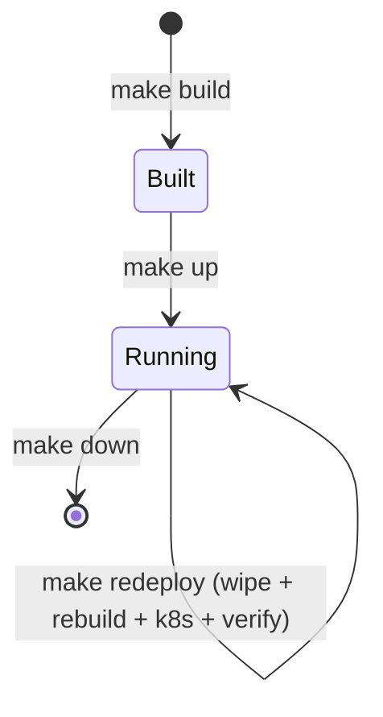
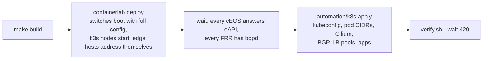

# DevOps guide

For people who run the lab: the host, the lifecycle (build, deploy, destroy), the CI/CD pipeline, telemetry
export, troubleshooting. Background: [architecture](architecture.md) sections 8–10.

## The host

| | |
|---|---|
| Host | `192.168.20.56`, Ubuntu 24.04, 64 vCPU, 117 GB RAM, user `samrat` (SSH key) |
| Repo | `~/hackathon/netops-lab` (an SMB share, see pitfalls) |
| Lab runtime dirs | `~/clab-runs/clab-netops/` (local disk; `CLAB_LABDIR_BASE`) |
| Lab bundle | `~/clab-runs/netops-bundle/`: the copy of `containerlab/` the running lab is deployed from (local disk) |
| Lab lock | `~/clab-runs/.netops.lock`: one job at a time against the lab, for CI and people alike |
| Tools | containerlab 0.80, Docker, Python venv `~/.venvs/netops` (Ansible + AVD), `~/.local/bin/{terraform,kubectl}`, `yq`, `jq` |
| Bootstrap a new host | `bash automation/bootstrap.sh` (packages, venv, collections, kubectl, images; asks for sudo once) |
| Images | `ceos:4.36.2F` must be imported by hand (Arista login); everything else is pulled |

The lab uses about 30 GB of RAM: 14 cEOS at about 1.5 GB each, 6 k3s nodes at about 1 GB, and the rest is small.

## Lifecycle



| Command | Does | Time |
|---|---|---|
| `make build` | `network/` + `kubernetes/` → `generated/` + `containerlab/` (offline) | ~30 s |
| `make up` | build, deploy the lab, wait for switches, `make k8s`, `make verify` | ~10 min |
| `make redeploy` | same, but wipes the running lab first (needed when nodes or links change) | ~10 min |
| `make down` | destroy the lab (also drops the Terraform state) | ~1 min |
| `make plan` / `make apply` | network config diff / push (EOS config replace, FRR reload, hosts); `apply` syncs the lab bundle first | ~1 min |
| `make sync` | refresh the lab bundle from `containerlab/` (gnmic targets, otelcol, scripts); never the topology | seconds |
| `make k8s-plan` / `make k8s` | Terraform plan / apply inside Kubernetes | ~1–10 min |
| `make verify` | all health checks; non-zero exit on any failure | ~1 min |
| `make status` | containerlab node list | — |
| `make graph` | live topology on `http://192.168.20.56:50080` | — |
| `make check-build` | CI gate: fresh build must equal the committed `generated/` and `containerlab/` | ~30 s |

Helpers:

| Helper | Use |
|---|---|
| `automation/lab up / down / redeploy / status / wait` | what the make targets call (sets `CLAB_LABDIR_BASE`) |
| `automation/lab converge` | what CI deploys with: redeploy if the topology differs from what is running (or the lab is down), else `sync` |
| `automation/lab locked <cmd>` | run any command holding the lab lock |
| `automation/lab cli <node>` | EOS CLI, `vtysh` on WAN routers, a shell elsewhere |
| `automation/lab netem …` | `containerlab tools netem` (delay, loss, jitter, rate on a link) |
| `automation/k8s kubeconfig / plan / apply / destroy` | Kubernetes Terraform wrapper (state path, kubeconfig, provider cache) |
| `automation/k8s kubectl …` | kubectl with `~/.kube/netops.yaml` |

What `make up` does, in order:



## GitOps pipeline

| Workflow | Trigger | Steps |
|---|---|---|
| `plan.yml` | pull request to `main` | `make check-build` → `make plan` → plan posted as a PR comment |
| `deploy.yml` | push to `main` | `make check-build` → `automation/lab converge` (redeploy only if the running topology differs from `main`) → `make apply` → `automation/k8s apply` → `verify.sh --wait 420` → change event |
| `drift.yml` | every 15 min | `make plan` against `main`; opens or updates a `drift` issue if a device differs |

They run on a **self-hosted runner** labelled `netops-lab` on the lab host.

How runs are kept apart:
- **The lab lock** (`~/clab-runs/.netops.lock`, in `automation/lab`) serialises everything that touches the lab:
  `make plan` / `apply`, `automation/k8s plan` / `apply` / `destroy`, `automation/lab up` / `redeploy` /
  `converge` / `sync` / `down`. A second job waits up to 30 minutes and says so. It covers people at the
  terminal too, so a `make apply` by hand never lands in the middle of a CI deploy.
- **Each workflow has its own concurrency group.** GitHub keeps only one *pending* run per group and cancels
  the older one, so a shared group would let a scheduled drift run cancel a queued deploy.
  - `netops-deploy`: a newer deploy may replace a pending one. That is safe, because `converge` compares the
    running topology with the new `main` rather than with the previous commit.
  - `netops-plan-<PR>`: a new push to a PR cancels that PR's running plan.
  - `netops-drift`: drift runs never cancel anything else.

To enable the pipeline:
1. **Register the runner.** GitHub → repo → Settings → Actions → Runners → New self-hosted runner (Linux).
   Install it on the lab host as user `samrat` with the label `netops-lab`.
2. **Add the repository secrets.**

   | Secret | What |
   |---|---|
   | `EOS_USER` / `EOS_PASSWORD` | switch credentials (lab default admin/admin) |
   | `ELASTIC_ES_URL` / `ELASTIC_API_KEY` | where change events are sent (optional) |

3. **Set the reviewers.** Replace `@NETWORK-REVIEWERS` in `.github/CODEOWNERS` with a real team, and protect
   `main` (require PRs and code-owner review).
4. **Fork pull requests.** The repo is public, so make it private, or require approval for workflows from
   fork PRs. A self-hosted runner executes PR code on the lab host.

## Telemetry export to Elastic

Details, data reference and troubleshooting: [streaming telemetry guide](telemetry.md).

```bash
cp automation/elastic.env.example automation/elastic.env     # git-ignored
# fill ELASTIC_OTLP_ENDPOINT (Elastic Cloud -> Observability -> Add data -> OpenTelemetry -> managed OTLP)
# and ELASTIC_API_KEY
make redeploy          # otelcol starts with the elastic profile
```
- **Without the file**, telemetry stays local. Check it on the host with
  `curl -s localhost:9464/metrics | grep -c ^gnmi_`.
- **With the file**, otelcol sends OTLP to Elastic. A disk-backed queue rides out short Elastic outages.

## Traffic and faults

```bash
# baseline: inet-k6 already sends 10 req/s to the public VIP (network/wan.yml: TARGET, RPS)
docker logs -f clab-netops-inet-k6

# SYN flood from the attacker (capped at 20 Mbit/s on its uplink)
docker exec clab-netops-attacker1 nping --tcp -p 80 --flags syn --rate 2000 -c 100000 192.0.2.10

# DCI load: iperf3 from DC1 pods to DC2 pods for 60 s
automation/k8s kubectl -n prod exec deploy/iperf3-dc1 -- iperf3 -c iperf3-dc2.prod -t 60 -P 4

# degrade a WAN link: 80 ms delay, 2 % loss on wan2's link to dc1-bgw1
automation/lab netem set -n clab-netops-wan2 -i eth1 --delay 80ms --loss 2
automation/lab netem show -n clab-netops-wan2
automation/lab netem reset -n clab-netops-wan2 -i eth1

# fail a DC's web pods and watch the VIP move
automation/k8s kubectl -n prod scale deploy/web --replicas=0     # then back with make k8s
```
`make k8s` restores the declared state after any manual `kubectl` change. Terraform is the source of truth.

## Troubleshooting

| Symptom | Look at | Usual cause / fix |
|---|---|---|
| `make up` fails at "Failed to verify bind path" | the path in the message | a file the topology binds is missing from `containerlab/`: `make build` |
| `lab is busy ... waiting up to 30 min` | `fuser -v ~/clab-runs/.netops.lock` | another CI job or someone's `make` holds the lab lock; it continues by itself when that finishes |
| `WARNING: netops.clab.yml changed but the lab is not re-wired yet` | `git diff` of the topology | nodes or links changed: `make redeploy` (CI does it by itself on merge) |
| A node's links are gone after a crash | `docker inspect <node> --format '{{.RestartCount}}'` | a Docker restart creates a new network namespace. Linux nodes are `restart-policy: "no"`; `make redeploy` |
| k3s node keeps logging `entrypoint: k3s exited` | `docker logs clab-netops-<node>` | normal for a few tries while the first server boots; persistent means cp1's API is unreachable: check the node's leaf with `show ip bgp summary vrf PROD` |
| Nodes `NotReady` after `make up` | `automation/k8s kubectl get pods -n kube-system` | Cilium not running yet; `make k8s` again and read the error |
| Terraform "state lock" error | is another terraform running? `pgrep -af terraform` | if none: `terraform -chdir=kubernetes/terraform force-unlock <ID>` with `TF_DATA_DIR=~/.cache/netops/terraform-kubernetes` |
| A pod stays `Pending` | `kubectl describe pod` | spread / affinity rules: workloads only run in zones `dc1`, `dc2` |
| `make verify` VIP check fails | `show ip bgp vrf PROD <vip>/32` on the leaf | no ready pod in that DC (the VIP is withdrawn by design) or the leaf's session to its node is down |
| Drift issue opened | the issue's diff | someone or something changed a device by hand; merge the change into `network/` or let `make apply` revert it |
| `make plan` shows changes after a fresh deploy | the diff | a generated file is out of date: `make build`, commit |

## Pitfalls specific to this host

- **The repo is on an SMB share, the lab is not.** The lab runs from `~/clab-runs/netops-bundle/` on local
  disk. A container that bind-mounts a file straight from the share gets `Stale file handle` once that file
  is replaced there (git checkout, tar, an editor), which is what broke the first CI deploy. So
  `automation/lab` copies `containerlab/` to the bundle with `rsync --inplace` (a bind-mounted file keeps
  its inode), and the FRR role runs scripts from the job's own checkout. On the share itself: no symlinks,
  no `chmod`, and `git switch` can fail on files the Mac has open.
- **Keep runtime state off the share**: `CLAB_LABDIR_BASE=~/clab-runs`, the venv, the Terraform provider
  cache (`~/.cache/netops/`).
- **Management subnet 172.20.20.0/24** is owned by this lab's Docker network `clab-mgmt`. Another lab on the
  host must use a different one.
- **Other labs on the host** (`clab-chaos2cure-*`, `c2c-*`) belong to a colleague. Don't touch them.
