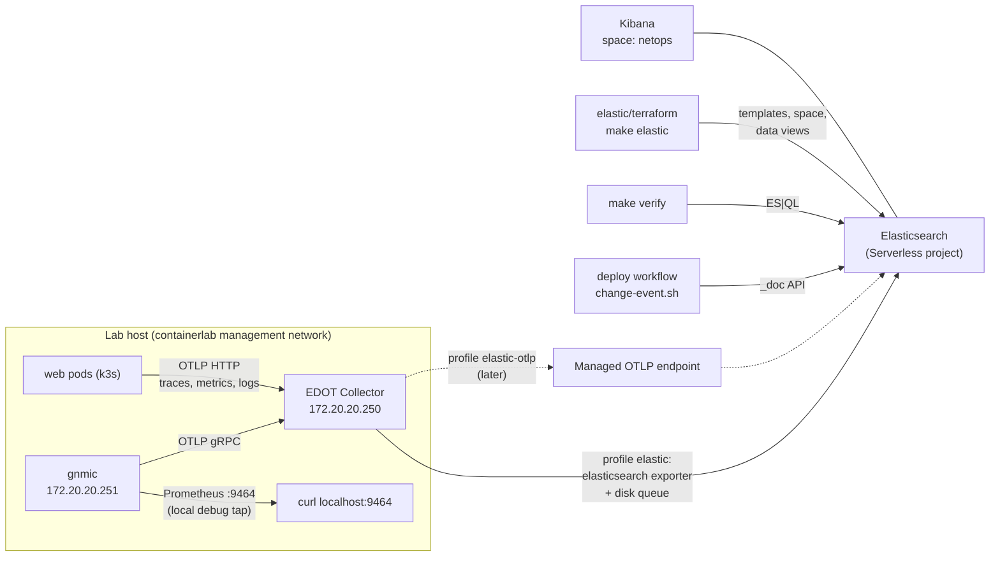

# Elastic

How the lab gets its telemetry into Elastic, and how the Elastic side is managed as code.

| | |
|---|---|
| **Elastic project** | Elastic Cloud **Serverless**, project type **Elasticsearch**, version 9.6, AWS `ap-southeast-2`. Shared with the agent work, so the lab writes only to its own data streams |
| **How data gets there** | The lab collector (EDOT Collector) writes straight to the Elasticsearch endpoint with the `elasticsearch` exporter. The project has no Managed OTLP endpoint; the collector is ready for one (profile `elastic-otlp`) |
| **Managed as code** | `elastic/terraform/` (the `elastic/elasticstack` provider): data stream templates, the `netops` Kibana space, data views, the lab API key's privileges |
| **Secrets** | Only in the git-ignored `automation/elastic.env` on the lab host, and in GitHub repository secrets for CI. Never in git, never in a container's environment |

Contents:
1. [How it fits together](#1-how-it-fits-together)
2. [Settings and keys](#2-settings-and-keys)
3. [First-time setup](#3-first-time-setup)
4. [Collector profiles](#4-collector-profiles)
5. [Data streams](#5-data-streams)
6. [elastic/terraform](#6-elasticterraform)
7. [Checking it works](#7-checking-it-works)
8. [Operating it](#8-operating-it)
9. [Moving to a Managed OTLP endpoint later](#9-moving-to-a-managed-otlp-endpoint-later)
10. [Known limits](#10-known-limits)

---

## 1. How it fits together



| Piece | Where | What it does |
|---|---|---|
| EDOT Collector | `otelcol` node, image `docker.elastic.co/elastic-agent/elastic-otel-collector:9.5.5` | receives OTLP from gnmic and the web app, adds the data contract, sends to Elastic |
| Collector config | `containerlab/telemetry/otelcol/` | `base.yml` + one profile (`local`, `elastic`, `elastic-otlp`) |
| Profile + secrets | written by `automation/lab` into the running bundle (`~/clab-runs/netops-bundle/telemetry/otelcol/`) | `profile.yml` and `secrets/` (mode 600) |
| Settings loader | `automation/elastic-env.sh` | one place that reads the Elastic settings; used by `lab`, `elastic`, `verify.sh`, `change-event.sh` |
| Terraform | `elastic/terraform/`, run by `automation/elastic` | everything inside the Elastic project |
| Change events | `automation/change-event.sh` | one document per deploy in `logs-netops.changes-default` |
| Freshness checks | `automation/verify.sh` (section `== Elastic ==`) | ES\|QL: every switch sent data in the last 2 minutes, collector health, web traces |

---

## 2. Settings and keys

All settings are environment variables. On the lab host they live in `automation/elastic.env` (git-ignored;
template: `automation/elastic.env.example`). In CI they come from repository secrets. A variable already set
in the environment wins over the file.

| Variable | Used by | In CI? | What |
|---|---|---|---|
| `ELASTIC_ES_URL` | collector (`elastic`), change events, verify, Terraform | yes, secret | Elasticsearch endpoint, `https://<project>.es.<region>.aws.elastic.cloud` |
| `ELASTIC_API_KEY` | collector, change events, verify | yes, secret | the **lab key** (below) |
| `ELASTIC_OTLP_ENDPOINT` | collector (`elastic-otlp`) | optional secret | Managed OTLP endpoint. Empty today |
| `ELASTIC_KIBANA_URL` | Terraform | no | Kibana endpoint, `https://<project>.kb.<region>.aws.elastic.cloud` |
| `ELASTIC_TF_API_KEY` | Terraform | **no, never** | the **admin key** (below) |

Two API keys:

| Key | Name in Kibana | Privileges | Lives in |
|---|---|---|---|
| Admin key | `LAB_HACKATHON KEY` (or any) | your own (no restriction) | `ELASTIC_TF_API_KEY`, lab host only |
| Lab key | `netops-lab` | write `logs-*-*`, `metrics-*-*`, `traces-*-*`; read the lab's own data streams; cluster `monitor` | `ELASTIC_API_KEY`, lab host and CI |

The lab key's privileges are code (`elastic/terraform/security.tf`), but the key itself is created by hand
once: Elasticsearch doesn't let an API key create another API key with privileges, and on Serverless people
sign in through Elastic Cloud, so Terraform has no user to create it as.

---

## 3. First-time setup

On the lab host, in `~/hackathon/netops-lab`:

1. **Settings file.** `cp automation/elastic.env.example automation/elastic.env`, then fill in
   `ELASTIC_ES_URL`, `ELASTIC_KIBANA_URL` and `ELASTIC_TF_API_KEY` (Kibana → API keys → Create, no privilege
   restriction, encoded format).
2. **Elastic side.** `make elastic` (Terraform apply). A second `make elastic-plan` must say `No changes`.
3. **Lab key.** `automation/elastic role` prints the role descriptor. In Kibana → API keys → Create API key:
   name `netops-lab`, turn on **Control security privileges**, paste the JSON, create, copy the **encoded**
   key into `ELASTIC_API_KEY` in `automation/elastic.env`.
4. **Collector.** `make sync`. The lab helper writes the `elastic` profile and the secrets into the bundle and
   restarts the collector (management-only, safe to restart).
5. **CI.** `automation/elastic gh-secrets` copies `ELASTIC_ES_URL`, `ELASTIC_OTLP_ENDPOINT` (if set) and
   `ELASTIC_API_KEY` into the repository secrets. It needs repository admin rights, so the owner runs it.
6. **Check.** `make verify`: the `== Elastic ==` section must pass.

---

## 4. Collector profiles

The collector runs `--config /etc/otelcol/base.yml --config /etc/otelcol/profile.yml`. `automation/lab`
chooses the profile every time it copies the bundle (`make up`, `make redeploy`, `make sync`, `make apply`,
CI `converge`):

| Profile | Chosen when | Exports to |
|---|---|---|
| `local` | `ELASTIC_API_KEY` empty | nothing; `debug` exporter only |
| `elastic` | `ELASTIC_API_KEY` and `ELASTIC_ES_URL` set | `elasticsearch/elastic`: Elasticsearch bulk API, OTel-native mapping, disk-backed queue |
| `elastic-otlp` | `ELASTIC_API_KEY` and `ELASTIC_OTLP_ENDPOINT` set (wins over `elastic`) | `otlp_http/elastic` with `Authorization: ApiKey …`, disk-backed queue |

How the secrets reach the collector:
- `automation/lab` writes `secrets/es_url`, `secrets/otlp_endpoint` and `secrets/api_key` into the bundle's
  `telemetry/otelcol/` with mode 600, and copies the chosen profile to `profile.yml`.
- The profiles read them with `${file:/etc/otelcol/secrets/...}`. The values are never in the container's
  environment, `docker inspect`, `netops.clab.yml` or git.
- The bundle sync (`rsync --delete`) leaves `profile.yml` and `secrets/` alone.
- If any file under a telemetry node's folder changed, `automation/lab` restarts that node. Only gnmic and
  the collector are restarted this way: they have no data-plane links.

The committed `containerlab/telemetry/otelcol/profile.yml` is a copy of `local.yml` (made by `make build`), so a
plain `containerlab deploy` of the bundle works and exports nothing.

---

## 5. Data streams

The `elasticsearch` exporter routes each signal to `<type>-<dataset>.otel-default`. The collector's
`transform/contract` sets the dataset per source:

| Data stream | Source | Retention | Notes |
|---|---|---|---|
| `metrics-gnmi.otel-default` | gnmic (14 cEOS switches) | 7 days | time series data stream (TSDS); template `metrics-gnmi.otel`. Counters are `counter_double`: use `TS … RATE()` or `TO_DOUBLE()` |
| `metrics-otelcol.otel-default` | the collector's own metrics (scraped from `127.0.0.1:8888`; resource `service.name: elastic-otel-collector`) | 3 days | accepted / refused / sent / failed points, queue size |
| `traces-generic.otel-default` | web pods | project default | `service.name: web` |
| `metrics-generic.otel-default` | web pods (HTTP server duration, runtime) | project default | |
| `logs-generic.otel-default` | web pods, when they send logs | project default | |
| `logs-netops.changes-default` | `automation/change-event.sh` (CI deploy) | project default | ECS document per deploy |

Every gNMI document carries these resource attributes (searchable without the `resource.attributes.`
prefix): `host.name` and `device` (the switch), `site`, `role`, `vendor`, `lab: netops`,
`service.name: gnmic`. Metric names and data-point attributes are described in
[telemetry.md § Data reference](telemetry.md#6-data-reference).

Other data streams in the project (for example `logs-network.frr-default`, `logs-scm.changes-default`) belong to
other work in the same project. The lab never writes to them.

---

## 6. elastic/terraform

| File | Holds |
|---|---|
| `main.tf` | provider (`elastic/elasticstack ~> 0.16`), local backend |
| `data-streams.tf` | one index template per lab metrics dataset. Each reuses Elasticsearch's built-in `metrics-otel@template` as-is (read live through a data source, so Elastic upgrades carry through) and adds a retention |
| `security.tf` | the lab key's role descriptor (output `lab_api_key_role_descriptors`) |
| `kibana.tf` | Kibana space `netops` and data views: fabric telemetry, app traces, change events, collector health |

| Command | Does |
|---|---|
| `make elastic-plan` / `automation/elastic plan` | Terraform plan |
| `make elastic` / `automation/elastic apply` | Terraform apply |
| `automation/elastic role` | prints the lab key's role descriptor |
| `automation/elastic gh-secrets` | copies the CI settings into the repository secrets (owner only) |
| `automation/elastic output` | Terraform outputs |

- **Auth.** The wrapper passes `ELASTIC_ES_URL`, `ELASTIC_KIBANA_URL` and `ELASTIC_TF_API_KEY` to the provider as
  `ELASTICSEARCH_ENDPOINTS`, `ELASTICSEARCH_API_KEY`, `KIBANA_ENDPOINT` and `KIBANA_API_KEY`. No credential is in
  a `.tf` file or on a command line.
- **State.** `~/.local/share/netops/terraform-elastic.tfstate` on the lab host. Unlike the Kubernetes state it
  is not in the lab directory: Elastic outlives `make down`.
- **Who applies.** For now, the lab host owner runs `make elastic` after merging a change under `elastic/`. CI
  doesn't apply it, because the admin key stays off GitHub.

Later roadmap steps add lookup indices, transforms, rules, SLOs and dashboards here
([observability-roadmap.md](observability-roadmap.md)).

---

## 7. Checking it works

```bash
make verify                               # == Elastic == section: switches, collector health, web traces
docker logs --tail 30 clab-netops-otelcol  # export errors show up here
```

In Kibana, switch to the **NetOps lab** space, then Discover with the data views, or run ES|QL:

```esql
// every switch, last 2 minutes
FROM metrics-gnmi.otel-*
| WHERE @timestamp > NOW() - 2 minutes
| STATS docs = COUNT(*) BY host.name
| SORT host.name
```

```esql
// BGP sessions not established right now
FROM metrics-gnmi.otel-*
| WHERE @timestamp > NOW() - 2 minutes
  AND gnmi_network_instances_network_instance_protocols_protocol_bgp_neighbors_neighbor_state_session_state IS NOT NULL
| STATS state = MAX(gnmi_network_instances_network_instance_protocols_protocol_bgp_neighbors_neighbor_state_session_state)
    BY host.name, `network-instance_name`, `neighbor_neighbor-address`
| WHERE state < 6
```

```esql
// web spans: slowest endpoints in the last 15 minutes
FROM traces-*.otel-*
| WHERE @timestamp > NOW() - 15 minutes AND service.name == "web"
| STATS spans = COUNT(*), p95_ms = PERCENTILE(duration, 95) / 1000000 BY name
| SORT p95_ms DESC
```

```esql
// collector health: export queue fill and what was sent (counters are TSDS counters: TO_DOUBLE for MAX)
FROM metrics-otelcol.otel-*
| WHERE @timestamp > NOW() - 15 minutes
| STATS queue = MAX(otelcol_exporter_queue_size), capacity = MAX(otelcol_exporter_queue_capacity),
        sent_points = MAX(TO_DOUBLE(otelcol_exporter_sent_metric_points)), sent_spans = MAX(TO_DOUBLE(otelcol_exporter_sent_spans))
    BY exporter
| WHERE exporter IS NOT NULL
```

`otelcol_exporter_send_failed_*` only appears once a send has failed; its absence is good news.

```esql
// what changed recently
FROM logs-netops.changes-default
| SORT @timestamp DESC
| KEEP @timestamp, git.sha, git.message, git.author, netops.changed_devices, event.outcome
| LIMIT 10
```

---

## 8. Operating it

| Task | How |
|---|---|
| Rotate the lab key | create a new `netops-lab` key (step 3 of the setup), update `automation/elastic.env`, `make sync`, `automation/elastic gh-secrets`, then delete the old key in Kibana |
| Turn Elastic export off | empty `ELASTIC_API_KEY` in `automation/elastic.env`, then `make sync` (profile `local`) |
| Change the collector config | edit `containerlab/telemetry/otelcol/*.yml`, `make sync` (restarts the collector if anything changed) |
| Change the Elastic side | edit `elastic/terraform/*.tf`, `make elastic-plan`, PR, merge, `make elastic` |

| Symptom | Look at | Usual cause / fix |
|---|---|---|
| `make verify`: `0/14 switches` | `docker logs clab-netops-otelcol` | profile is `local` (`grep -c elasticsearch ~/clab-runs/netops-bundle/telemetry/otelcol/profile.yml`), or a wrong key (`401` / `403` in the log) |
| `403 ... action [indices:data/write/bulk...] is unauthorized` | collector log | the lab key lacks a privilege; recreate it from `automation/elastic role` |
| CI deploy turns Elastic off | `collector profile: local` in the deploy log | the repository secrets are not set: `automation/elastic gh-secrets` |
| `metrics-gnmi` shows up as a regular (not time series) data stream | `GET _data_stream/metrics-gnmi.otel-default` | the template was created after the data stream: roll it over with `POST metrics-gnmi.otel-default/_rollover` |
| Terraform: `creating derived api keys requires an explicit role descriptor that is empty` | | expected: API keys can't create keys with privileges. Create the lab key in Kibana |

---

## 9. Moving to a Managed OTLP endpoint later

The project type decides it: Serverless **Observability** projects (and Elastic Cloud Hosted 9.x) have a
Managed OTLP endpoint; this Elasticsearch project does not. The Observability apps (APM, Infrastructure,
SLOs) also need an Observability project, and later roadmap steps (SLOs, synthetic checks) rely on them.

To switch, nothing in the repo has to change:
1. Put the endpoint in `ELASTIC_OTLP_ENDPOINT` (in `automation/elastic.env`, and the `ELASTIC_OTLP_ENDPOINT`
   repository secret).
2. `make sync`. The collector moves to `elastic-otlp`.
3. If the project changed, update `ELASTIC_ES_URL`, `ELASTIC_KIBANA_URL` and both keys, then `make elastic`.

The `elastic-otlp` profile validates but hasn't sent data yet. Expect to check the `endpoint` form (with or
without a path) on first use.

---

## 10. Known limits

- **No downsampling.** Serverless sets retention only (7 days for `metrics-gnmi`); the 1-minute downsampling
  in the roadmap is not configured.
- **The lab key is created by hand,** once (see [section 2](#2-settings-and-keys)).
- **Terraform runs from the lab host,** not from CI.
- **The disk queue is inside the collector container** (`/tmp/otelcol-queue`). It survives a restart, not a
  `make redeploy`.
- **Only `gnmi` and `otelcol` have their own templates.** The web app's data goes to the `generic` datasets
  with the project's default retention.
