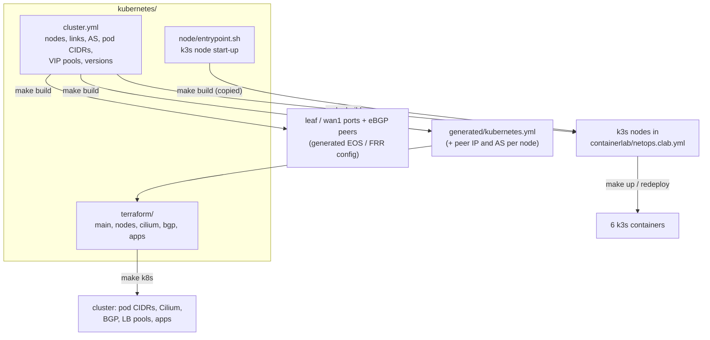

# Kubernetes guide

For people who run the cluster platform: the k3s nodes, Cilium, BGP to the fabric, load-balancer pools, and
upgrades. App teams should read the [developer guide](developer-guide.md) instead.
Background: [architecture](architecture.md) sections 5–6.

## What you are operating



| Component | Version / setting | Where |
|---|---|---|
| k3s | `rancher/k3s:v1.36.5-k3s1` | `cluster.yml` → `k3s_image` |
| Cilium | 1.20.2 (Helm chart `cilium/cilium`) | `cluster.yml` → `cilium_version`; values in `terraform/cilium.tf` |
| Datastore | embedded etcd on the 3 servers | k3s `--cluster-init` on the first server |
| Disabled k3s add-ons | flannel, network policy, traefik, servicelb | `render.py` (k3s args) |
| Kept k3s add-ons | CoreDNS, kube-proxy, metrics-server, local-path storage | — |
| Kubeconfig | `~/.kube/netops.yaml` → `https://172.20.20.61:6443` | written by `automation/k8s kubeconfig` |

## How a node starts

`kubernetes/node/entrypoint.sh` is the container's entrypoint. Containerlab runs it with the k3s
arguments generated from `cluster.yml`.

1. Wait for `eth1` (containerlab plugs links after start). Address it with the node's `/31` (MTU 1500, same
   as the leaf port). Route `10.0.0.0/8`, `192.0.2.0/24`, `198.51.100.0/24` and `203.0.113.0/24` over it.
   Everything else, including image pulls, uses `eth0` (management).
2. **cgroup v2.** Move every process out of the container's root cgroup and enable the controllers. The
   kubelet needs this, and k3s only does it itself when it is PID 1.
3. **Cilium.** Make `/` an rshared mount and mount a shared `bpffs` on `/sys/fs/bpf`.
4. Run k3s, and **retry if it exits** (a joining server fails while the first server is still booting).
   The container must never exit: a Docker restart would drop its links.

All k3s arguments are generated, so look at `cmd` in `containerlab/netops.clab.yml`. The key ones:
- `--node-ip` and `--advertise-address`: the fabric address.
- `--flannel-backend=none` and `--disable-network-policy`: Cilium is the CNI.
- `--kube-controller-manager-arg=allocate-node-cidrs=false`: Terraform sets pod CIDRs.
- `--cluster-cidr=10.0.0.0/11` and `--service-cidr=10.43.0.0/16`.
- `--node-label=topology.kubernetes.io/zone=<dc1|dc2|wan>`.
- `--node-taint=node-role.kubernetes.io/control-plane=true:NoSchedule` on the tie-breaker only.

## What Terraform manages

| File | Resources |
|---|---|
| `main.tf` | providers (kubernetes, helm, alekc/kubectl, external), reads `generated/kubernetes.yml`; local backend (path set by `automation/k8s`) |
| `nodes.tf` | `terraform_data.pod_cidr`: waits for each node, sets `spec.podCIDR` once. `terraform_data.image`: copies images from the host's Docker (`docker save` → `ctr import`): the web app into each workload node, the EDOT Collector into every node |
| `cilium.tf` | `helm_release.cilium`: native routing, `ipam.mode=kubernetes`, `ipv4NativeRoutingCIDR=10.0.0.0/8`, BGP control plane, kube-proxy kept, Hubble on (no relay) |
| `bgp.tf` | one `CiliumBGPClusterConfig` per node (its AS, its switch as the peer), `CiliumBGPPeerConfig` `fabric` (3 s / 9 s timers, graceful restart), `CiliumBGPAdvertisement` (PodCIDR + LoadBalancerIP), two `CiliumLoadBalancerIPPool`s |
| `apps.tf` | namespace `prod`, `web` Deployment + PDB + two LoadBalancer Services, `db` placeholder, `iperf3-*` per zone |
| `observability.tf` | namespace `otel`: the EDOT Collector as `otel-agent` (DaemonSet, every node: kubelet stats, container logs, k8s metadata) and `otel-cluster` (Deployment, 1 replica: cluster state, events), read-only RBAC; OTLP to the lab gateway `172.20.20.250:4317` over each node's eth0. Data streams: [elastic.md § 5](elastic.md#5-data-streams) |

Order on a fresh lab: pod CIDRs → Cilium (waits until ready) → BGP and pools → apps, and the collectors once their image is in every node.

Run it:
```bash
make k8s-plan     # = automation/k8s plan
make k8s          # = automation/k8s apply
automation/k8s destroy   # removes everything Terraform made (the k3s nodes stay)
```
The wrapper:
- fetches the kubeconfig and waits for the API;
- runs `terraform init` with the state in `~/clab-runs/clab-netops/terraform-kubernetes.tfstate`;
- keeps provider binaries in `~/.cache/netops/terraform-kubernetes` (off the SMB share).

## Day-2 tasks

### Check health
```bash
automation/k8s kubectl get nodes -o wide          # 6 Ready, INTERNAL-IP = fabric address
automation/k8s kubectl -n kube-system get pods    # cilium-*, cilium-operator, coredns ... Running
make verify                                       # includes pod-CIDR routes on the leaves and VIP checks
```

### Check BGP from the cluster side
Full Cilium reference (config, packet paths, BGP, VIPs, Hubble, troubleshooting): [cilium.md](cilium.md).
```bash
# sessions of the node the agent pod runs on (pick a node with -l / --field-selector, or loop)
automation/k8s kubectl -n kube-system exec ds/cilium -c cilium-agent -- cilium-dbg shell -- bgp/peers
automation/k8s kubectl -n kube-system exec ds/cilium -c cilium-agent -- cilium-dbg shell -- bgp/routes
automation/k8s kubectl get ciliumbgpclusterconfigs,ciliumbgppeerconfigs,ciliumbgpadvertisements
automation/k8s kubectl get ciliumloadbalancerippools
```
And from the fabric side: `automation/lab cli dc1-leaf1` → `show ip bgp summary vrf PROD`,
`show ip route vrf PROD 10.11.0.0/24`.

### Add or move a node
1. Add it to `kubernetes/cluster.yml`: role (`server` / `agent`), zone, switch, port, a free `/31`, the zone's
   AS, a free pod `/24` from the zone's block, a free management IP (`.61`–`.69`).
2. `make build`, review the leaf diff (`generated/intended/configs/<leaf>.cfg`).
3. `make redeploy`. New containers and cables need a redeploy, and that also re-applies Terraform. The new
   node gets its pod CIDR, its BGP session and, if it is in a workload zone, the lab-built images.

Keep an **odd number of servers** (3). Adding a fourth server weakens quorum instead of strengthening it.

### Change the VIP pools or add a pool
Edit `load_balancer_pools` in `cluster.yml` and `make build`. Then make sure the switches accept the range:
- `PL-K8S-IN` in `network/group_vars/DC1.yml` / `DC2.yml` lists what leaves accept from nodes;
- `PL-WAN-PROD-OUT` decides whether the range reaches the WAN.

`make build`, `make apply`, `make k8s`.

### Upgrade
| What | How |
|---|---|
| Cilium | bump `cilium_version` in `cluster.yml`, `make build`, `make k8s-plan`, `make k8s` (Helm upgrade in place) |
| k3s | bump `k3s_image` in `cluster.yml`, `make build`, `make redeploy` (nodes are rebuilt; the lab is ephemeral) |
| Terraform providers | `terraform -chdir=kubernetes/terraform init -upgrade` with the same `TF_DATA_DIR`, commit `.terraform.lock.hcl` |

### Failover drill
```bash
automation/k8s kubectl -n prod get pods -l app=web -o wide          # 2 in dc1, 2 in dc2
automation/k8s kubectl cordon dc1-k8s-cp1 dc1-k8s-wk1 dc1-k8s-wk2   # no new pods in DC1
automation/k8s kubectl -n prod delete pod -l app=web --field-selector spec.nodeName=dc1-k8s-cp1
automation/k8s kubectl -n prod delete pod -l app=web --field-selector spec.nodeName=dc1-k8s-wk2
# DC1 nodes withdraw 192.0.2.10/32; wan2 now has only the 65200 65201 paths:
docker exec clab-netops-wan2 vtysh -c 'show bgp vrf PROD ipv4 192.0.2.10/32'
automation/k8s kubectl uncordon dc1-k8s-cp1 dc1-k8s-wk1 dc1-k8s-wk2 && make k8s
```
While DC1 is cordoned, the two replacement pods stay `Pending`. The zone spread rule (max skew 1) won't
stack all of them in DC2, so DC2's two pods carry the traffic on their own. That is expected, and the
Pending pods are a useful signal in their own right. Without the cordon, the scheduler would simply recreate
the pods in DC1 within seconds.

## Gotchas (all already handled; know them before changing things)

| Gotcha | Handled by |
|---|---|
| A Docker restart gives a container a new network namespace, so its links vanish | `restart-policy: "no"` on linux nodes; the entrypoint retries k3s instead of exiting |
| containerlab 0.80 checks bind sources before creating node dirs | no per-node bind for k3s data; the k3s image's `VOLUME /var/lib/rancher/k3s` keeps it on host disk |
| cgroup v2 "no internal processes" error from the kubelet | cgroup evacuation in `entrypoint.sh` |
| Cilium: `/sys/fs/bpf ... not a shared mount` | `mount --make-rshared /` + shared bpffs in `entrypoint.sh` |
| With flannel off, containerd reads CNI from `/etc/cni/net.d`, `/opt/cni/bin` | Cilium's defaults (no `cni.*` overrides) |
| `k3s ctr` is not in this k3s build | `ctr --address /run/k3s/containerd/containerd.sock` |
| A node's containerd only exists once its k3s has joined; on a cold deploy the DC2 nodes join last | `terraform_data.image` waits up to 10 min for the containerd socket before importing images |
| A timed-out Cilium Helm install leaves the release outside Terraform state | `helm_release.cilium` waits up to 15 min; if it still happens, see `cannot re-use a name` in the [DevOps guide](devops-guide.md#troubleshooting) |
| `spec.podCIDR` can only be set once | `nodes.tf` refuses to change it; a new CIDR needs a redeploy |
| The tie-breaker zone `wan` would count as a spread domain | `web` has a node affinity for zones `dc1`, `dc2` |
