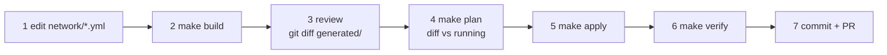

# Network engineer's guide

For people who change the fabric: VLANs, VRFs, routing, policy, switches, links and the WAN.
You work in **`network/`** (and `kubernetes/cluster.yml` when a change touches the k8s node links).
You never hand-edit a switch: every change is YAML → `make build` → review → `make apply`.

Background reading: [architecture](architecture.md) sections 2–4 and the [IP plan](ip-plan.md).

## The workflow



1. **Edit** a file in `network/` (table below).
2. **`make build`** (~30 s, offline). AVD validates the YAML against its schema; errors stop here.
3. **Review** the exact EOS lines: `git diff generated/intended/configs/`. Readable per-device tables are in
   `generated/documentation/devices/<switch>.md`.
4. **`make plan`**: per-device diff of the running switches against the build. Nothing changes.
5. **`make apply`**: EOS gets a full config replace over eAPI (anything not in `network/` is removed); FRR
   gets `frr-reload`; hosts get their addresses.
6. **`make verify`**: OSPF, BGP/EVPN, multi-site isolation, pings, VRF PROD handoff, Kubernetes routes, VIPs.
7. **Commit** `network/`, `generated/` and `containerlab/` together, and open a PR. CI repeats steps 2–4 and
   posts the plan to the PR. A merge deploys (see the [DevOps guide](devops-guide.md#gitops-pipeline)).

On a shared lab, prefer: branch → PR → let CI post the plan → merge, instead of running `make apply` yourself.

## Which file do I edit?

| I want to change… | Edit |
|---|---|
| Underlay / overlay protocol choice, OSPF process and area | `network/group_vars/FABRIC/routing.yml` |
| VRFs, VLANs, SVIs, anycast gateways, VNIs | `network/group_vars/FABRIC/vlans-vrfs.yml` |
| Which leaves carry a VLAN | `filter.tags` of the leaf in `network/group_vars/DC1.yml` / `DC2.yml` |
| A DC's AS, loopback / VTEP / uplink pools, spines, leaves, border gateways | `network/group_vars/DC1.yml`, `DC2.yml` |
| EVPN gateway (multi-site) peers, I-ES, domain IDs | `node_groups[].evpn_gateway` in `DC1.yml` / `DC2.yml` |
| BGW ↔ WAN eBGP neighbors (underlay) | `structured_config.router_bgp` of each BGW in `DC1.yml` / `DC2.yml` |
| Route policy: what k8s nodes may announce, what goes to / comes from the WAN | `structured_config` under `l3leaf.defaults` in `DC1.yml` / `DC2.yml` (`PL-*`, `RM-*`, `AS-*-LOCAL`) |
| BGW ↔ WAN links and their IPs | `network/group_vars/FABRIC/cabling.yml` (`l3_edge`) |
| Management VRF, users, eAPI, gNMI | `network/group_vars/FABRIC/management.yml` |
| Servers (which leaf port, VLAN, IP) | `network/hosts.yml` |
| WAN routers, VRF PROD handoff, edge sites (Internet users, attacker) | `network/wan.yml` |
| Kubernetes node ↔ leaf links, node AS numbers | `kubernetes/cluster.yml` |
| Add or remove a switch | `network/inventory.yml` **and** its DC file |

Two conventions in these files:
- **Plain block YAML.** Write lists as `- item` lines, not inline `[a, b]` maps.
- **Quote values YAML 1.1 would misread**, such as `"1:1"`. Unquoted, YAML 1.1 reads it as a base-60 number.

## Common changes

### Add a VLAN to some leaves
```yaml
# network/group_vars/FABRIC/vlans-vrfs.yml, under tenants[PROD].vrfs[PROD].svis
          - id: 140
            name: CACHE
            tags:
              - cache
            enabled: true
            ip_address_virtual: 10.10.50.1/24
```
Then add `cache` to `filter.tags` of the leaves that need it in `DC1.yml`. The L2 VNI is automatically
`10000 + id`. `make build` and review `generated/intended/configs/dc1-leaf*.cfg`.

### Plug a new server into a leaf
```yaml
# network/hosts.yml
  dc1-cache1:
    switch: dc1-leaf3
    port: Ethernet6
    vlan: 140
    ip: 10.10.50.11/24
```
A new host is a new container and cable. `make build`, then `make redeploy`: the topology changed, and
CI's deploy job does this by itself.

### Change routing policy
The route-maps are YAML in `DC1.yml` / `DC2.yml`:
```yaml
      prefix_lists:
        - name: PL-WAN-PROD-OUT            # what this DC hands to the WAN
          sequence_numbers:
            - sequence: 10
              action: deny 10.10.30.0/24 le 32
```
After `make build`, the diff shows the exact `ip prefix-list` and `route-map` lines; `make plan` shows which
BGWs change. Keep DC1 and DC2 symmetrical unless the asymmetry is the point.

### Add a Kubernetes node (network side)
Add it to `kubernetes/cluster.yml` (switch, port, `/31`, AS, pod `/24`, management IP). `make build` generates
the leaf's `Ethernet` port in VRF PROD, the eBGP peer with `RM-K8S-IN` / `RM-K8S-OUT`, the topology node, and
the Terraform input. See the [Kubernetes guide](kubernetes-guide.md#add-or-move-a-node).

## Looking at the network

| What | Command / file |
|---|---|
| EOS CLI on a switch | `automation/lab cli dc1-leaf1` |
| FRR shell on a WAN router | `automation/lab cli wan1` |
| Intended config | `generated/intended/configs/<switch>.cfg` |
| Readable docs per switch | `generated/documentation/devices/<switch>.md` |
| Fabric-wide tables (all links and IPs) | `generated/documentation/fabric/FABRIC-documentation.md` |
| Diagram | VS Code → Containerlab extension → TopoViewer on `containerlab/netops.clab.yml`, or `make graph` |
| Live telemetry | Elastic: Kibana space **NetOps lab**, data view *Fabric telemetry (gnmic)*; or `curl -s localhost:9464/metrics \| grep gnmi_` on the lab host |

Useful show commands:

| Question | EOS | FRR (`vtysh`) |
|---|---|---|
| Underlay up? | `show ip ospf neighbor` | — |
| Overlay up? | `show bgp evpn summary` | — |
| Remote VTEPs seen by a leaf | `show vxlan vtep` (only own-DC VTEPs is correct) | — |
| Tenant routes | `show ip route vrf PROD` | `show ip route vrf PROD` |
| k8s node / WAN peers in the VRF | `show ip bgp summary vrf PROD` | `show bgp vrf PROD summary` |
| Who announces a VIP | `show ip bgp vrf PROD 192.0.2.10/32` | `show bgp vrf PROD ipv4 192.0.2.10/32` |
| Policy hits | `show route-map RM-WAN-PROD-OUT` | — |

## Verify

`make verify` runs every check and exits non-zero on any failure. It checks:
- OSPF adjacencies
- every BGP session (EVPN, WAN, VRF PROD)
- that leaves only see own-DC VTEPs
- six pings (L2, L3 and between DCs)
- the Kubernetes nodes are Ready and every node's pod /24 is in its switch's VRF PROD table
- the public and internal VIPs answer from the right places, and the attacker **cannot** reach the internal VIP
- gnmic telemetry is flowing

## Rules

- **Never configure a switch by hand.** The next `make apply` or the drift job reverts it, and drift is reported.
- **Never `docker restart` a switch, router, host or k3s node.** It loses its links. Use `make redeploy`.
- **Every change goes through a PR** reviewed by `@NETWORK-REVIEWERS`. That includes the Auto-SRE agent's.
