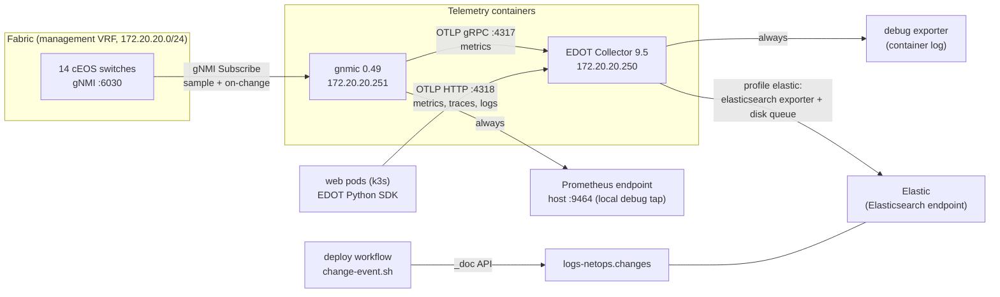
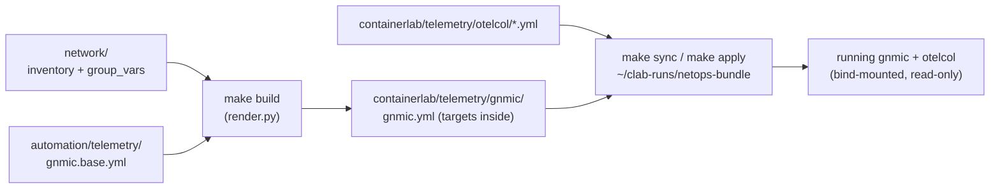
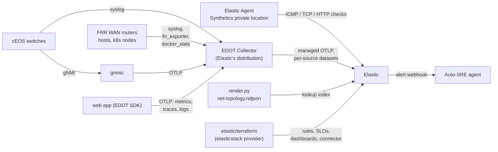

# Streaming telemetry

How the lab streams network state to Elastic: what runs, what it collects, what the data looks like, how to
operate and extend it, and what is still missing. The Auto-SRE agent reads this data, so this guide is also
the reference for the data it consumes.

| | |
|---|---|
| **Works today** | All 14 cEOS switches stream gNMI to gnmic, then over OTLP to the EDOT Collector (Elastic's OpenTelemetry distribution), which writes to Elastic. Route, BGP, port, LLDP and EVPN changes go to `logs-gnmi.state` as documents. The web app's traces, metrics and logs take the same path. About 1,900 live series. |
| **Not yet** | WAN routers, hosts, syslog, routes, flows, Kubernetes and Cilium are not collected. See [Known gaps](#9-known-gaps) and the [roadmap](observability-roadmap.md). The Elastic side (keys, data streams, Terraform) is described in [elastic.md](elastic.md). |

Contents:
1. [Architecture](#1-architecture)
2. [Where it is defined](#2-where-it-is-defined)
3. [Device side: gNMI on cEOS](#3-device-side-gnmi-on-ceos)
4. [gnmic: the collector](#4-gnmic-the-collector)
5. [OpenTelemetry Collector: the gateway](#5-opentelemetry-collector-the-gateway)
6. [Data reference](#6-data-reference)
7. [Elastic](#7-elastic)
8. [Operating it](#8-operating-it)
9. [Known gaps](#9-known-gaps)
10. [Roadmap (proposed)](#10-roadmap-proposed)
11. [Design decisions](#11-design-decisions)

---

## 1. Architecture



| Component | Image | Address | Ports | Role |
|---|---|---|---|---|
| cEOS switches (14) | `ceos:4.36.2F` | `172.20.20.11`–`.28` (see [IP plan](ip-plan.md)) | gNMI `6030/tcp`, MGMT VRF | source of all network state |
| `gnmic` | `ghcr.io/openconfig/gnmic:0.49.0` | `172.20.20.251` | `9464` (Prometheus debug tap, published on the host) | subscribes to every switch, turns updates into OTLP metrics |
| `otelcol` | `docker.elastic.co/elastic-agent/elastic-otel-collector:9.5.5` (EDOT Collector) | `172.20.20.250` | `4317` gRPC, `4318` HTTP (lab only) | adds the data contract, exports every signal to Elastic |

Both telemetry containers are management-only nodes: they have no data-plane links, so they run with
`restart-policy: always` and may be restarted freely (unlike the switches, see the
[DevOps guide](devops-guide.md)).

**Signal flow, end to end:**
1. A switch sends a gNMI notification (every 10 or 30 s for counters, immediately for state changes).
2. gnmic turns each value into an event and tags it with `source`, `site`, `role` and `vendor`.
3. gnmic's event processors then:
   - drop ports the device does not use;
   - turn state enums into numbers;
   - convert everything to floats.
4. gnmic sends the events as OTLP metrics. Counters become cumulative monotonic sums; everything else becomes gauges.
5. The collector adds `host.name`, `device`, `lab` and `data_stream.dataset: gnmi`, then exports to Elastic
   (profile `elastic`), where the data lands in `metrics-gnmi.otel-default`.
6. gnmic also serves the same series on `:9464` (Prometheus format). That is only a local debug tap, and the
   fallback check in `make verify`.

---

## 2. Where it is defined

Everything is generated from the repo; nothing on the host is hand-edited.

| File | Edit? | What it holds |
|---|---|---|
| `automation/telemetry/gnmic.base.yml` | **yes** | subscriptions, processors, the OTLP output and the Prometheus debug tap |
| `containerlab/telemetry/otelcol/base.yml` | **yes** | collector receivers, processors, pipelines (metrics, traces, logs) |
| `containerlab/telemetry/otelcol/elastic.yml` | **yes** | profile `elastic`: the `elasticsearch` exporter and the disk queue |
| `containerlab/telemetry/otelcol/elastic-otlp.yml` | **yes** | profile `elastic-otlp`: OTLP to a Managed OTLP endpoint (for later) |
| `containerlab/telemetry/otelcol/local.yml` | **yes** | profile `local`: nothing exported |
| `containerlab/telemetry/otelcol/profile.yml` | no, generated | copy of `local.yml`; `automation/lab` overwrites it in the running bundle |
| `containerlab/telemetry/gnmic/gnmic.yml` | no, generated | the base file plus the per-device `used-ports` filter |
| `automation/render.py` (section `# ---- telemetry`) | code | builds the generated files and the `gnmic` and `otelcol` nodes in `netops.clab.yml` |
| `automation/lab` (`collector_profile`) | code | picks the collector profile, writes the Elastic secrets into the bundle, restarts changed telemetry nodes |
| `automation/elastic.env` | yes, **git-ignored** | Elastic settings and keys, see [elastic.md](elastic.md#2-settings-and-keys) |
| `automation/change-event.sh` | code | the per-deploy change event |
| `automation/verify.sh` (section `== Telemetry ==`) | code | the telemetry check in `make verify` |



Notes on generation:
- **Targets follow the inventory.** A switch added under `network/` gets a gnmic target, with its `site` and
  `role` tags, on the next `make build`. There's no telemetry file to touch.
- **The `used-ports` filter** is built from each device's `ethernet_interfaces` and `loopback_interfaces` in the AVD output, plus
  `Vxlan1` where the device is a VTEP. cEOS exposes 16 Ethernet ports, and without the filter the unused ones would
  add about 60 % more interface series.
- **The running containers read from the bundle**, `~/clab-runs/netops-bundle`, not from the repo
  checkout. `make sync` (or `make apply`, which runs it) copies the files there in place, and restarts
  gnmic or the collector if any of their files changed.

---

## 3. Device side: gNMI on cEOS

Every switch gets this from AVD (`network/group_vars/FABRIC/management.yml`):

```
management api gnmi
   transport grpc default
      vrf MGMT
   provider eos-native
```

| Property | Value |
|---|---|
| Port | `6030`, in VRF `MGMT` (the containerlab management network) |
| Transport | plain gRPC, no TLS (`insecure: true` in the targets) |
| Authentication | the device user, `EOS_USER` / `EOS_PASSWORD` (lab default `admin` / `admin`), passed to gnmic as `GNMIC_USERNAME` / `GNMIC_PASSWORD` |
| Models | OpenConfig (gNMI 0.7.0) plus Arista's native paths through `provider eos-native` (origin `eos_native`, the Sysdb and Smash state trees) |
| Encoding | `json_ietf` |

Check it on a switch: `automation/lab cli dc1-leaf1`, then `show management api gnmi`. It should say
`Server: running on port 6030, in MGMT VRF` and `Octa: enabled`. Octa is the eos-native provider.

Also from `management.yml`, on every switch:

| Config | Why | EOS |
|---|---|---|
| OpenConfig route tables (`custom_structured_configuration_eos_cli`, AVD doesn't model it) | fills `/network-instances/network-instance/afts`: per-VRF IPv4/IPv6 routes with their next hops, for path walks | `management api models` → `provider aft` → `ipv4-unicast`, `ipv6-unicast` |
| Syslog (`logging_settings`) | events (link, BGP, config) to the lab collector over VRF `MGMT`; RFC 5424 with high-resolution timestamps carries the UTC offset. **Nothing is sent yet**: rsyslog crash-loops inside cEOS on this host (see [Known gaps](#9-known-gaps)) | `logging vrf MGMT host 172.20.20.250 514`, `logging format rfc5424`, `logging format timestamp high-resolution`, `logging trap informational` |
| Clock (`timezone`) | the lab runs Australia/Sydney (AEST / AEDT) on every device; Elastic stores UTC regardless | `clock timezone Australia/Sydney` |

**sFlow test (dc1-leaf1 only).** `network/group_vars/DC1.yml` gives dc1-leaf1 `sflow sample 100`,
`polling-interval 30`, destination `172.20.20.250:6343` in VRF `MGMT`. It answers one question: does cEOS in a
container send samples at all? **Yes:** hardware samples count up in `show sflow`, and sFlow v5 datagrams reach
172.20.20.250:6343. Nothing collects them yet ([roadmap step 10](observability-roadmap.md#step-10--sflow--goflow2--elastic)).

---

## 4. gnmic: the collector

One gnmic container holds a long-lived subscription to every target. The targets are written into
`gnmic.yml` by `make build`; any change (targets or subscriptions) is applied by `make sync`, which restarts
gnmic. There is deliberately no target file loader: gnmic 0.49's loader saw every target as changed on each
30 s reload and re-subscribed all of them, so the switches resent their whole state (every route and MAC) twice
a minute. See [Operating it](#8-operating-it).

### Subscriptions

Each subscription names its outputs: `otel` (metrics to Elastic), `prom` (local debug tap) and `state` (the
change history, see [State documents](#state-documents-logs-gnmistate)).

| Name | Path | Mode | Outputs | Why the agent needs it |
|---|---|---|---|---|
| `if-counters` | `/interfaces/interface/state/counters` | sample 10 s | otel, prom | traffic, errors, discards, carrier flaps per port |
| `if-mtu` | `/interfaces/interface/subinterfaces/subinterface/ipv4/state/mtu` | sample 300 s | otel, prom | MTU mismatches (a classic silent fault) |
| `bgp-prefixes` | `.../bgp/neighbors/neighbor/afi-safis/afi-safi/state/prefixes` | sample 30 s | otel, prom | route counts per session: a leak, a withdrawal or a policy mistake |
| `platform` | `/components/component/state/memory` | sample 30 s | otel, prom | control-plane memory |
| `ospf` | `eos_native:/Sysdb/routing/ospf/status` | sample 30 s | otel, prom | LSA count per instance: moves with every underlay topology change |
| `if-state` | `/interfaces/interface/state/oper-status` | on change | otel, prom, state | link up/down within a second |
| `bgp-state` | `/network-instances/network-instance/protocols/protocol/bgp/neighbors/neighbor/state/session-state` | on change | otel, prom, state | underlay, overlay, WAN and Kubernetes BGP sessions |
| `lldp` | `/lldp/interfaces/interface/neighbors/neighbor/state/{system-name,port-id}` | on change | otel, prom, state | actual cabling, to compare with the intended cabling |
| `aft` | `/network-instances/network-instance/afts/{ipv4-unicast/ipv4-entry/state, ipv6-unicast/ipv6-entry/state, next-hop-groups/next-hop-group, next-hops/next-hop}` | on change | state | every route in every VRF, and where it points: route added, changed, withdrawn |
| `evpn` | `eos_native:/Sysdb/vxlan/remoteVtepHwConfig/vtepConfig`, `Vxlan1 arista-vxlan/{vlan-to-vnis,vrf-to-vnis}`, `eos_native:/Smash/bridging/status/smashFdbStatus` | on change | state | remote VTEPs, VNI mappings, MAC learn / move / age-out |

Not collected, on purpose:
- **CPU:** cEOS reports the lab host's 64 cores (`CPU0`…`CPU63`) for every switch, not the switch (896
  meaningless series). Per-switch CPU comes from the container stats ([roadmap Step 12](observability-roadmap.md)).
- **OSPF neighbours:** cEOS 4.36 has no OSPF adjacency state over gNMI (OpenConfig `ospfv2` is config only,
  and the EOS-native status has no neighbour table). A lost adjacency shows up as withdrawn OSPF routes in the
  `aft` state documents and as an LSA count change.
- **MAC counts as a metric:** the MAC table is in the state documents (learn, move, age-out); a count is an
  ES|QL aggregation over them.

### Event processors (in order)

| Processor | Type | Outputs | Does |
|---|---|---|---|
| `used-ports` | `event-drop` (generated) | all | drops interface events for ports the device doesn't use |
| `names` | `event-starlark` | otel, prom | gNMI path → short metric name (the [catalogue](#metrics)); anything not in the catalogue is dropped. `oper-status`: `UP` → 1, anything else → 0. `session-state`: `IDLE` 1, `CONNECT` 2, `ACTIVE` 3, `OPENSENT` 4, `OPENCONFIRM` 5, `ESTABLISHED` 6, so each state is one numeric series that can be thresholded |
| `now` | `event-override-ts` (ns) | otel, prom | stamps the collection time. cEOS keeps the device timestamp of an unchanged value, so idle counters would be re-sent with an old timestamp (Elastic drops them as duplicates, and they look stale) |
| `numbers` | `event-convert` | otel, prom | every remaining value → float |
| `state-docs` | `event-starlark` | state | values → `state.<leaf>`, `op` = `update` / `delete`; EOS-native tables (VTEPs, MACs) split into one event per entry with the key as a tag; 64-bit ids → strings. Keeps the device timestamp: the time of the change |

### Outputs

| Output | Type | Where | Notes |
|---|---|---|---|
| `otel` | `otlp` (gRPC) | `172.20.20.250:4317`, the collector | no prefix: metric name = the short name (`net.if.in_octets`). `resource-tag-keys` `source`, `site`, `role`, `vendor` become **resource** attributes; path keys (`interface_name`, `neighbor_neighbor-address`, …) stay **data-point** attributes. `counter-patterns` (`octets\|pkts\|packets\|errors\|discards\|drops\|messages`) are sent as cumulative counters, the rest as gauges. `strings-as-attributes`: a string value (an LLDP neighbour name) becomes attribute `value` on a series whose value is 1 |
| `state` | `file`, `format: event`, `split-events` | `/var/lib/netops-state/gnmi-state.json` | one JSON event per line; rotated at 20 MB, 2 backups. The folder is `telemetry/state/` in the lab bundle, bound by gnmic and the collector (gnmic runs as uid 1000, the collector's user, so the collector can read the file) |
| `prom` | `prometheus` | `:9464` on the lab host | local debug tap only, prefix `gnmi`: `gnmi_net_if_in_octets` |

---

## 5. OpenTelemetry Collector: the gateway

The collector is the **EDOT Collector** (Elastic Distribution of OpenTelemetry), started with two config
files merged in order: `--config /etc/otelcol/base.yml --config /etc/otelcol/profile.yml`.

| Profile | Chosen when | Adds |
|---|---|---|
| `local` | no `ELASTIC_API_KEY` | info-level logging only. Telemetry stays in the lab |
| `elastic` | `ELASTIC_ES_URL` + `ELASTIC_API_KEY` | the `elasticsearch/elastic` exporter (OTel-native mapping) and a disk-backed queue |
| `elastic-otlp` | `ELASTIC_OTLP_ENDPOINT` + `ELASTIC_API_KEY` | the `otlp_http/elastic` exporter to a Managed OTLP endpoint (ready, not used yet) |

`automation/lab` chooses the profile and writes the URL and key into files only the collector reads, every
time it copies the bundle, and restarts the collector when they change. Details in
[elastic.md § Collector profiles](elastic.md#4-collector-profiles).

### The pipeline today

```
receivers:  otlp (gRPC 0.0.0.0:4317, HTTP 0.0.0.0:4318), prometheus/self (the collector's own metrics),
            file_log/gnmi_state (gnmic's state file, /var/lib/netops-state/gnmi-state*.json)
metrics:    otlp, prometheus/self    -> memory_limiter -> cumulative_to_delta/histograms -> transform/contract -> debug [, elasticsearch/elastic]
traces:     otlp                     -> memory_limiter -> transform/contract -> debug [, elasticsearch/elastic]
logs:       otlp, file_log/gnmi_state -> memory_limiter -> transform/gnmi_state -> transform/contract -> debug [, elasticsearch/elastic]
```

- **`transform/contract`** sets resource attributes:
  - on metrics: `host.name` and `device` = `source`; `lab` = `netops`; `data_stream.dataset` = `gnmi` for
    gnmic and `otelcol` for the collector's own metrics;
  - on traces and logs: `lab` = `netops`.
- **`file_log/gnmi_state`** tails gnmic's state file (with its rotated copies), parses each JSON line,
  takes the device's change time as the timestamp, and moves the switch (`source` → `host.name`, `device`;
  `site`, `role`, `vendor`) into the record's **resource**, as on the metrics. It has to be the resource: a
  logsdb index has its own top-level `host.name`, which hides a record-level one. Read offsets are kept in `file_storage/state`
  (`/var/lib/netops-state/otelcol`), next to the file, so a collector restart or a lab redeploy doesn't send
  old lines again. (The EDOT Collector has no TCP log receiver, hence the shared file.)
- **`transform/gnmi_state`** flattens a gnmic event into one log record: tags (keys) and `state.*` values
  become attributes, `data_stream.dataset` = `gnmi.state`, the body is a one-line summary
  (`dc1-leaf1 aft delete`).
- **`memory_limiter`** refuses data before the collector runs out of memory.
- **`cumulative_to_delta/histograms`** turns cumulative histograms (the web app's HTTP durations) into delta
  ones: Elasticsearch accepts only delta histograms and the exporter would drop them otherwise.
- **`prometheus/self`** scrapes the collector's own metrics from `127.0.0.1:8888`: points accepted, refused,
  sent and failed, and the queue size.
- **`debug`** (verbosity `basic`) logs one line per batch to the container log.

**Other senders:** the web app (`kubernetes/terraform/apps.tf`) sends traces, metrics and logs to
`http://172.20.20.250:4318` with Elastic's OpenTelemetry Python distribution (EDOT).

---

## 6. Data reference

### Attributes on every gNMI series

| Attribute | Level | Example | Source |
|---|---|---|---|
| `host.name` | resource | `dc1-leaf1` | collector (`= source`) |
| `device` | resource | `dc1-leaf1` | collector (`= source`) |
| `source` | resource | `dc1-leaf1` | gnmic target name |
| `site` | resource | `dc1`, `dc2` | inventory, via the targets in `gnmic.yml` |
| `role` | resource | `spine`, `leaf`, `bgw` | inventory |
| `vendor` | resource | `arista` | render.py |
| `lab` | resource | `netops` | collector |
| `service.name` | resource | `gnmic` | gnmic output |
| `deployment.environment` | resource | `hackathon` | gnmic output |
| `subscription-name` | data point | `if-counters` | gnmic |
| path keys | data point | `interface_name`, `network-instance_name`, `neighbor_neighbor-address`, `afi-safi_afi-safi-name`, `component_name`, `neighbor_id` | the gNMI path |

In Elastic the attribute names keep gnmic's hyphens, so ES|QL needs backticks: `` `neighbor_neighbor-address` ``.
The Prometheus debug tap turns hyphens into underscores (`neighbor_neighbor_address`). Metric names are short
(`net.*`, below); the attribute names stay gnmic's (decided 2026-10-13: readable custom names over the
OpenTelemetry hardware conventions, see [Design decisions](#11-design-decisions)).

### Metrics

Names are short and dotted, set by the `names` processor in `gnmic.base.yml` (the one place to change them).
They are also the field names in Elastic. The Prometheus debug tap writes them as `gnmi_net_if_in_octets`
(and adds `_total` to counters). The original gNMI path is in the second column; a datapoint's
`subscription-name` says which subscription it came from.

| Metric | gNMI path | Type | Labels (besides resource) | Meaning |
|---|---|---|---|---|
| `net.if.{in,out}_octets` | `/interfaces/interface/state/counters/{in,out}-octets` | counter | `interface_name` | bytes |
| `net.if.{in,out}_{pkts,unicast_pkts,multicast_pkts,broadcast_pkts}` | `.../counters/{in,out}-{pkts,unicast-pkts,...}` | counter | `interface_name` | packets |
| `net.if.{in,out}_errors`, `net.if.in_fcs_errors` | `.../counters/{in,out}-errors`, `in-fcs-errors` | counter | `interface_name` | errors |
| `net.if.{in,out}_discards` | `.../counters/{in,out}-discards` | counter | `interface_name` | drops (congestion, policy, MTU) |
| `net.if.carrier_transitions` | `.../counters/carrier-transitions` | gauge | `interface_name` | link flaps (cumulative) |
| `net.if.oper_status` | `/interfaces/interface/state/oper-status` | gauge | `interface_name` | 1 = up, 0 = not up |
| `net.if.ipv4_mtu` | `/interfaces/interface/subinterfaces/subinterface/ipv4/state/mtu` | gauge | `interface_name`, `subinterface_index` | IPv4 MTU |
| `net.bgp.session_state` | `/network-instances/network-instance/protocols/protocol/bgp/neighbors/neighbor/state/session-state` | gauge | `network-instance_name`, `neighbor_neighbor-address` | 6 = ESTABLISHED, 1–5 = other FSM states |
| `net.bgp.prefixes.{received,installed,sent}` | `.../neighbor/afi-safis/afi-safi/state/prefixes/{received,installed,sent}` | gauge | + `afi-safi_afi-safi-name` | prefixes per session and address family (`best-paths`, `best-ecmp-paths`, `received-pre-policy` are not kept: series budget) |
| `net.ospf.lsa_count` | `eos_native:/Sysdb/routing/ospf/status/<vrf>/instanceStatus/<id>/numLsa` | gauge | `network-instance_name`, `ospf_instance` | LSAs in the database |
| `net.mem.{utilized,available}` | `/components/component/state/memory/*` | gauge | `component_name` | bytes |
| `net.lldp.neighbor.{system_name,port_id}` | `/lldp/interfaces/interface/neighbors/neighbor/state/{system-name,port-id}` | gauge = 1 | `interface_name`, `neighbor_id`, `value` (the neighbour's name or port) | actual LLDP neighbour |

### State documents (`logs-gnmi.state`)

Every route, BGP session, port state, LLDP neighbour, VTEP, VNI and MAC **change** is one document in
`logs-gnmi.state.otel-default` (logsdb, 30 days). After a gnmic (re)start each switch first sends its full
state, then only changes. EOS sends most leaves in their own notification, so one route is a few documents
that share its keys.

| Field | Example | Meaning |
|---|---|---|
| `@timestamp` | | the device's time of the change |
| `observed_timestamp` | | when the collector read it |
| `host.name`, `device` | `dc1-leaf1` | switch |
| `subscription-name` | `aft`, `bgp-state`, `if-state`, `lldp`, `evpn` | what kind of state |
| `op` | `update`, `delete` | `delete` = route withdrawn, MAC aged out, VTEP or neighbour gone |
| keys (tags) | `network-instance_name`, `ipv4-entry_prefix`, `ipv6-entry_prefix`, `next-hop-group_id`, `next-hop_index`, `neighbor_neighbor-address`, `interface_name`, `vtep`, `mac` + `fid` | which object |
| `state.<leaf>` | `state.next_hop_group`, `state.origin_protocol`, `state.session_state` (`ESTABLISHED`), `state.oper_status` (`UP`), `state.ip_address`, `state.intf`, `state.entryType` | the new value |
| `state.deleted_paths` | | on a delete: the gNMI path removed |

Following a route to its next hop: `ipv4-entry_prefix` → `state.next_hop_group` = `next-hop-group_id` of an
`aft` document → its `next-hop_index` → `state.ip_address` / interface of that next hop. AFT ids are 64-bit and
stored as strings.

### Volume (live, 14 switches, 2026-10-13)

| Group | Series | Note |
|---|---|---|
| Interfaces (`net.if.*`) | 1,085 | counters, oper-status and MTU on the used ports and loopbacks |
| BGP (`net.bgp.*`) | 690 | session state + 3 prefix counts per session and address family |
| LLDP | 80 | 2 per cabled port with a neighbour |
| Memory | 28 | |
| OSPF | 14 | LSA count per switch |
| **Total** | **1,897** | was about 3,600 before step 6 (896 of them were host CPU cores) |

State documents: after a gnmic (re)start each switch sends its full state (about 2,000 documents per switch,
mostly AFT and MAC leaves); after that only changes, a handful per minute on a quiet fabric.

---

## 7. Elastic

Setup, keys, profiles, data streams, Terraform and troubleshooting are in [elastic.md](elastic.md). In short:

| Data | Data stream |
|---|---|
| gNMI metrics | `metrics-gnmi.otel-default` (time series, 7 days) |
| gNMI state changes (routes, BGP, ports, LLDP, EVPN) | `logs-gnmi.state.otel-default` (logsdb, 30 days) |
| the collector's own metrics | `metrics-otelcol.otel-default` (3 days) |
| web app traces, metrics, logs | `traces-generic.otel-default`, `metrics-generic.otel-default`, `logs-generic.otel-default` |
| deploy change events | `logs-netops.changes-default` |

Elastic stores OpenTelemetry data with its OTel-native mapping:
- resource attributes go under `resource.attributes.*`;
- data-point attributes go under `attributes.*`;
- metric values are fields named after the metric.

The attribute objects are pass-through, so `host.name` and `interface_name` can be used directly in ES|QL.

### Starter ES|QL for the agent

`metrics-gnmi` is a time series data stream: counters (octets, packets, errors, discards) are typed
`counter_double`. Use `TS … | STATS SUM(RATE(…))` for rates, or wrap them in `TO_DOUBLE()` for `MAX`/`MIN`.
All the queries below were run against the live data.

```esql
// BGP sessions not established right now
FROM metrics-gnmi.otel-*
| WHERE @timestamp > NOW() - 2 minutes
  AND net.bgp.session_state IS NOT NULL
| STATS state = MAX(net.bgp.session_state)
    BY host.name, `network-instance_name`, `neighbor_neighbor-address`
| WHERE state < 6
```

```esql
// cabled ports that are down
FROM metrics-gnmi.otel-*
| WHERE @timestamp > NOW() - 2 minutes AND net.if.oper_status IS NOT NULL
| STATS up = MIN(net.if.oper_status) BY host.name, interface_name
| WHERE up == 0
```

```esql
// ports with errors or discards in the last 5 minutes
FROM metrics-gnmi.otel-*
| WHERE @timestamp > NOW() - 5 minutes
| STATS err = MAX(TO_DOUBLE(net.if.in_errors)) - MIN(TO_DOUBLE(net.if.in_errors)),
        dsc = MAX(TO_DOUBLE(net.if.in_discards)) - MIN(TO_DOUBLE(net.if.in_discards))
    BY host.name, interface_name
| WHERE err > 0 OR dsc > 0
```

```esql
// busiest ports right now (bits per second in)
TS metrics-gnmi.otel-*
| WHERE @timestamp > NOW() - 5 minutes
| STATS in_bps = SUM(RATE(net.if.in_octets)) * 8 BY host.name, interface_name
| WHERE in_bps IS NOT NULL
| SORT in_bps DESC
| LIMIT 10
```

```esql
// telemetry gap: switches silent for more than 60 s
FROM metrics-gnmi.otel-*
| WHERE @timestamp > NOW() - 15 minutes
| STATS last_seen = MAX(@timestamp) BY host.name
| WHERE last_seen < NOW() - 60 seconds
```

```esql
// routes withdrawn or changed in the last 15 minutes (a lost OSPF adjacency or BGP peer shows up here)
FROM logs-gnmi.state.otel-*
| WHERE @timestamp > NOW() - 15 minutes AND `subscription-name` == "aft"
  AND (`ipv4-entry_prefix` IS NOT NULL OR `ipv6-entry_prefix` IS NOT NULL)
| KEEP @timestamp, host.name, op, `network-instance_name`, `ipv4-entry_prefix`, `ipv6-entry_prefix`, state.origin_protocol, state.next_hop_group
| SORT @timestamp DESC
```

```esql
// BGP and port state history for one switch
FROM logs-gnmi.state.otel-*
| WHERE host.name == "dc1-leaf1" AND `subscription-name` IN ("bgp-state", "if-state")
| KEEP @timestamp, `subscription-name`, op, `neighbor_neighbor-address`, interface_name, state.session_state, state.oper_status
| SORT @timestamp DESC
| LIMIT 20
```

```esql
// what changed recently (line it up with when symptoms started)
FROM logs-netops.changes-default
| SORT @timestamp DESC
| KEEP @timestamp, git.sha, git.message, git.author, netops.changed_devices, event.outcome
| LIMIT 10
```

---

## 8. Operating it

### Health checks

```bash
make verify                                                     # local tap + the == Elastic == freshness checks
curl -s localhost:9464/metrics | grep -c '^gnmi_'               # series count on gnmic's debug tap (about 1,900)
curl -s localhost:9464/metrics | grep '^gnmi_' | grep -o 'source="[^"]*"' | sort | uniq -c   # per switch
docker logs --tail 50 clab-netops-gnmic                         # subscription errors, target reconnects
docker logs --tail 20 clab-netops-otelcol                       # one line per batch; export errors
tail -n 3 ~/clab-runs/netops-bundle/telemetry/state/gnmi-state.json   # latest state changes, as gnmic wrote them
```

### Ad hoc gNMI from the host

gnmic is not installed on the host. Run the same image on the lab management network:

```bash
GN="docker run --rm --network clab-mgmt ghcr.io/openconfig/gnmic:0.49.0 -u admin -p admin --insecure"
$GN -a 172.20.20.13:6030 capabilities                                              # models the switch supports
$GN -a 172.20.20.13:6030 get --path '/interfaces/interface[name=Ethernet1]/state' --format flat
$GN -a 172.20.20.13:6030 get --path 'eos_native:/Sysdb/routing/ospf/status' --format flat   # Arista native tree
$GN -a 172.20.20.13:6030 subscribe --path /interfaces/interface/state/oper-status --stream-mode on-change
```

### Changing what is collected

1. Edit `automation/telemetry/gnmic.base.yml`. Use block YAML, like the rest of the repo.
2. Check the path on one switch first, with `get` as above.
3. Run `make build` and review `git diff containerlab/telemetry/`.
4. Run `make sync`. It copies the files into the running lab's bundle and restarts gnmic, because its files
   changed. This is safe: the container has no data-plane links.
5. Check that the new series appear on `:9464` and in Elastic, then open a pull request. On merge, CI syncs
   the bundle and restarts gnmic the same way.

Collector changes (`containerlab/telemetry/otelcol/*.yml`) and Elastic setting changes work the same way:
`make sync` restarts the collector when anything it reads changed.

### Troubleshooting

| Symptom | Look at | Usual cause / fix |
|---|---|---|
| `no gnmi series on the gnmic local tap` in `make verify` | `docker logs clab-netops-gnmic` | switches not ready yet (wait for `automation/lab wait`), or gnmic exited on a bad config: fix `gnmic.base.yml`, `make build sync` |
| one switch missing from the per-device count | gnmic log for that target | gNMI disabled or the switch restarting; `show management api gnmi` on the switch |
| `rpc error: code = InvalidArgument ... path invalid` | the subscription in the gnmic log | the path isn't in the switch's models; check with `capabilities` and `get` |
| new subscription not showing | `docker logs clab-netops-gnmic` start-up lines | the running bundle is not updated: `make sync` (it restarts gnmic) |
| series for unused ports | `containerlab/telemetry/gnmic/gnmic.yml` `used-ports` | the port isn't in the device's AVD interfaces; `make build` regenerates the filter |
| nothing reaches Elastic | collector log; `collector profile:` line of `make sync` | profile is `local` (no key, or CI without the repository secrets); wrong key → `401` / `403` in the log. See [elastic.md § Operating it](elastic.md#9-operating-it) |
| `Stale file handle` from a telemetry container | `docker inspect` binds | the lab is running from the SMB checkout instead of the bundle; `make redeploy` |

---

## 9. Known gaps

Checked against the live lab. The paths marked ✗ were tried on `dc1-leaf1` / `dc1-bgw1`.

**Elastic and pipeline**
- CI keeps Elastic on only once the repository secrets are set ([elastic.md § First-time setup](elastic.md#3-first-time-setup)).
- The project has no Managed OTLP endpoint, so the collector writes straight to Elasticsearch. The
  `elastic-otlp` profile is ready for when it has one.
- One gnmic and one collector. The collector's own metrics reach Elastic; gnmic's do not, and no rule raises
  a "telemetry gap" yet.
- The export queue lives in `/tmp` inside the collector container: it survives a restart, not a redeploy.

**Data model**
- No neighbour context: a port or BGP session has no `peer_device`, `peer_interface`, `link_id` or
  `peer_as`. The switches do expose BGP `peer-as` and `description` (AVD sets it, e.g. `dc1-spine1_Loopback0`),
  but they are not subscribed.
- Metric names are 50–120 characters long.
- CPU per host core is a quarter of all series and carries no information.
- `counters_last_update` is a timestamp sent as a counter.
- LLDP is sent as metrics with value 1, when it's really topology data (since step 6 it is also in the state documents).
- No `host.name` / `host.type`, so Elastic's infrastructure views don't recognise the switches.

**Coverage**

| Wanted | Status |
|---|---|
| WAN routers (FRR): links, BGP | not collected. FRR has no gNMI. **This is where `netem` faults are injected.** |
| Latency and loss on any path | not collected. Delay and loss change no switch counter |
| Admin status, description | available (`/interfaces/interface/state/admin-status` = `UP`), not subscribed |
| MTU | `state/mtu` returns 0 on cEOS ✗; the L3 MTU (`subinterfaces/subinterface/ipv4/state/mtu`, 9214) is **collected** as `net.if.ipv4_mtu` (step 6) |
| BGW VRF handoff sub-interfaces (`Ethernet3.100`) | in the `used-ports` list, but no counters arrive ✗ (also empty under `subinterfaces/.../counters`) |
| OSPF neighbours | not available over gNMI on cEOS 4.36 ✗: OpenConfig `ospfv2` is config only, the native status has no neighbour table. **Collected instead:** the LSA count (`net.ospf.lsa_count`) and OSPF routes in the `aft` state documents (step 6) |
| EVPN / VXLAN | **collected** as state documents (step 6): remote VTEPs (`eos_native:/Sysdb/vxlan/remoteVtepHwConfig`), VNI mappings (`arista-vxlan`), MAC table (`eos_native:/Smash/bridging/status/smashFdbStatus`) |
| BFD sessions | model present, empty (BFD not configured) |
| Queue drops | model present, empty on cEOS ✗ |
| Syslog | configured on every switch, but rsyslog inside cEOS crash-loops on this host (`systemctl status rsyslog`: `status=1/FAILURE`, restarting every few seconds); a fresh cEOS with no logging config does the same. No switch syslog is sent. No collector receiver yet either |
| Routing table (OpenConfig AFT) | **collected** (step 6): every VRF's IPv4/IPv6 routes, next-hop groups and next hops, on change, as `logs-gnmi.state` documents |
| BGP RIB | still empty under OpenConfig; Arista native paths work |
| Flows (sFlow / IPFIX) | cEOS sFlow **works** (test on dc1-leaf1, step 5); no collector yet (step 10). IPFIX unproven |
| Hosts and Kubernetes nodes (network) | not collected |

---

## 10. Roadmap (proposed)

The step-by-step build plan, from network devices to Kubernetes, Cilium and the web app, is in
[observability-roadmap.md](observability-roadmap.md). This section keeps the design reasoning.

**Partly built.** Phase 0 below is done (see the roadmap's progress log). The aim is to use Elastic for as much as possible: its collector, its endpoint, its lookups,
alerts, SLOs and synthetic monitoring, with the Elastic side defined in Terraform.



### Phase 0: turn Elastic on and keep every signal
- **Collector:** replace `otelcol-contrib` with the **EDOT Collector**, Elastic's own distribution. The config
  format is the same.
- **Pipelines:** add `traces` and `logs` pipelines next to `metrics`, so the web app's traces and logs arrive.
- **Routing:** set `data_stream.dataset` per source, giving `metrics-gnmi.eos.otel-*`,
  `logs-syslog.network.otel-*` and `logs-netops.changes`.
- **One Elastic config for every path.** The collector, `change-event.sh` and CI read one endpoint and key:
  - the lab helper sources a host-local env file;
  - CI reads repository secrets.

  This closes the CI caveat in [section 7](#7-elastic).
- **Check one Elastic limitation:** if the endpoint accepts only delta histograms, set the app's metric
  temporality preference to delta, or add a cumulative-to-delta step.

### Phase 1: make the data easy for the agent
- **Topology lookup index.** `render.py` already knows every link, BGP session, VRF and VNI.
  - It writes `net-topology.ndjson`, which is loaded into an Elastic lookup index.
  - ES|QL `LOOKUP JOIN` then adds `peer_device`, `peer_interface`, `link_id`, `peer_as` and `session_type` at query time.
  - The intended cabling lives in the index; live LLDP shows the actual cabling, and a mismatch is a finding.
- **Short names** in the collector (`net.if.in_octets`, `net.if.oper_up`, `net.bgp.state`,
  `net.bgp.prefixes_received`), and `host.name` = device, `host.type` = role.
- **Less noise:**
  - one CPU value per switch;
  - drop `counters_last_update`;
  - LLDP becomes log events on change;
  - subscribe BGP `peer-as` and `description`.

### Phase 2: cover where the faults are

| Add | How |
|---|---|
| Admin status, description, L3 MTU | `state/admin-status`, `state/description` on change; `subinterfaces/subinterface/ipv4/state/mtu` on change |
| OSPF adjacencies | Arista native OSPF status paths, on change |
| EVPN / VXLAN | Arista native VTEP and MAC-table paths, every 30 s |
| BGW handoff counters | find a path that returns `Ethernet3.100` counters, likely Arista native |
| Syslog | `logging host 172.20.20.250` from AVD and FRR; collector `syslog` receiver → `logs-syslog.network` |
| WAN routers, hosts, k8s nodes | collector `docker_stats` receiver (per-container, per-interface counters), plus `frr_exporter` on wan1 and wan2 for BGP |
| Latency and loss | **Elastic Synthetics**: an Elastic Agent in the lab as a private location, running ICMP, TCP and HTTP checks from the WAN side and from each DC to the VIPs, loopbacks and the other DC. This is the only signal that sees `netem` delay and loss |
| Flows (later) | sFlow or IPFIX into Elastic's integrations, once cEOS sampling is confirmed to work in containers |

### Phase 3: the Elastic side as code
A new `elastic/terraform/` folder using the `elasticstack` Terraform provider, planned and applied by CI.
Agree with the Elastic owner who applies it. It holds:
- the topology lookup index;
- **alerting rules** (ES|QL), which are the agent's triggers:
  - a BGP session not established;
  - a cabled port down;
  - an error or discard rate above a threshold;
  - Synthetics loss or latency;
  - a telemetry gap of more than 60 s;
- **SLOs** for the public VIP, measured from the "Internet" side;
- dashboards: fabric health, WAN, per-device detail;
- a webhook connector from alerts to the agent;
- deploy annotations from `logs-netops.changes`.

### Phase 4: watch the pipeline itself
- **Self-metrics:** gnmic's API server metrics and the collector's own metrics, both into Elastic.
- **Queue:** move the disk queue to the local runtime directory, so it survives the container being recreated.
- **Verify against Elastic:** `make verify` asks Elastic (ES|QL count per device over 2 minutes, all 14
  required) instead of the local Prometheus endpoint.

**Order:** Phase 0 → topology index → syslog and Synthetics → alert rules → the rest.

**Open questions for the Elastic owner:**
1. Which Elastic is it: Cloud Hosted 9.x, or Serverless?
2. Can we use the managed OTLP endpoint?
3. Can a Fleet-enrolled Agent run in the lab as a Synthetics private location?

---

## 11. Design decisions

| Decision | Why | Instead of |
|---|---|---|
| gnmic as the gNMI client | open source, handles many targets, OTLP output, event processors for shaping data | Arista TerminAttr + CloudVision (licence, not in the lab); Telegraf (weaker gNMI processing) |
| OTLP to a collector, then to Elastic | one open protocol for network and app data; the collector adds the contract labels, batching and a disk queue; Elastic accepts OTLP natively | gnmic → Kafka → Logstash (more moving parts on one host); Prometheus remote-write |
| State enums as numbers | one series per state, easy to threshold and alert on (`session_state < 6`, `oper_status == 0`) | string values, which become one series per state |
| Drop unused ports at gnmic | about 60 % fewer interface series, and no "down" ports that were never cabled | filtering in Elastic |
| Collector profiles (`local` / `elastic` / `elastic-otlp`) | the lab works without Elastic credentials; the credentials never enter git; a Managed OTLP endpoint is a setting, not a code change | one config with empty variables |
| EDOT Collector, writing straight to Elasticsearch | Elastic's supported distribution; the project has no Managed OTLP endpoint | `otelcol-contrib` |
| Secrets as files read with `${file:…}` | not visible in `docker inspect` or the topology; a key change is a restart, not a redeploy | container environment variables |
| Local debug tap on gnmic, not the collector | the EDOT Collector has no Prometheus exporter; the tap still works without Elastic | a second collector |
| One gnmic, one collector | one host, one lab; a restart costs seconds of data | clustered gnmic with a locker, which isn't worth it here |
| Plain gRPC, lab credentials | a closed lab network | TLS and service accounts on gNMI |
| Short custom metric names (`net.*`), gnmic's attribute names | readable, one name per signal, decided 2026-10-13 | OpenTelemetry hardware conventions (`hw.network.io` + `network.io.direction`); there are none for BGP, routes or LLDP anyway |
| Data stream names and templates by Elastic's convention | `<type>-<dataset>.otel-<namespace>` picks Elastic's built-in OTel templates and index mode (TSDS for metrics, logsdb for logs); Terraform only adds retention | custom index names and mappings |
| State changes as log documents, not metrics | routes, MACs and next hops are strings and appear/disappear: a history of events, not a time series | string metrics with a `value` attribute (one series per route) |
| gnmic → shared JSON-lines file → collector `file_log` | the EDOT Collector has no TCP/UDP log receiver; a file survives a collector restart, offsets survive a redeploy | gnmic → Kafka; Beats receivers |
