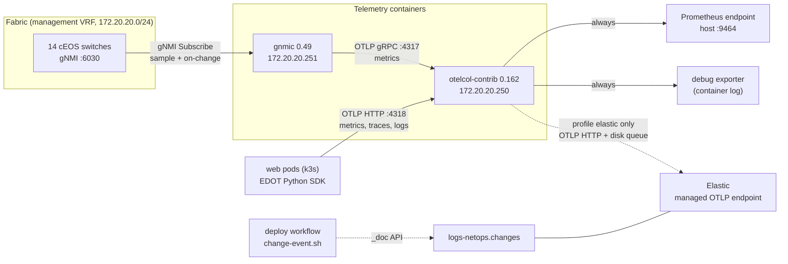
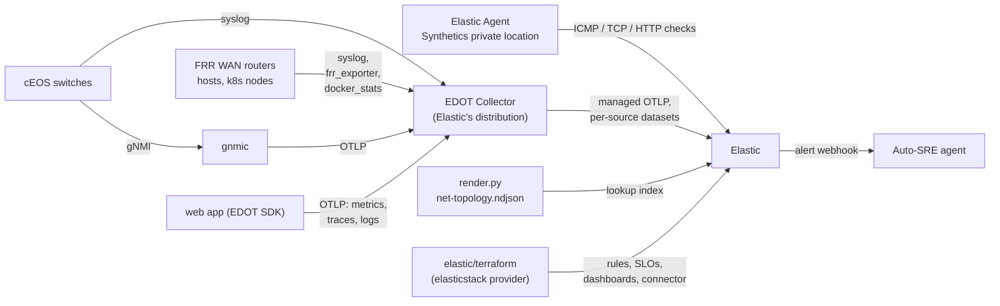

# Streaming telemetry

How the lab streams network state to Elastic: what runs, what it collects, what the data looks like, how to
operate and extend it, and what is still missing. The Auto-SRE agent reads this data, so this guide is also
the reference for the data it consumes.

| | |
|---|---|
| **Works today** | All 14 cEOS switches stream gNMI to gnmic, then over OTLP to an OpenTelemetry Collector. About 3,600 live series. |
| **Not yet** | Export to Elastic is built but off (no endpoint configured). Metrics only: traces and logs are dropped. WAN routers, hosts and syslog are not collected. See [Known gaps](#9-known-gaps) and the [roadmap](#10-roadmap-proposed). |

Contents:
1. [Architecture](#1-architecture)
2. [Where it is defined](#2-where-it-is-defined)
3. [Device side: gNMI on cEOS](#3-device-side-gnmi-on-ceos)
4. [gnmic: the collector](#4-gnmic-the-collector)
5. [OpenTelemetry Collector: the gateway](#5-opentelemetry-collector-the-gateway)
6. [Data reference](#6-data-reference)
7. [Elastic](#7-elastic)
8. [Operating it](#8-operating-it)
9. [Known gaps](#9-known-gaps)
10. [Roadmap (proposed)](#10-roadmap-proposed)
11. [Design decisions](#11-design-decisions)

---

## 1. Architecture



| Component | Image | Address | Ports | Role |
|---|---|---|---|---|
| cEOS switches (14) | `ceos:4.36.2F` | `172.20.20.11`–`.28` (see [IP plan](ip-plan.md)) | gNMI `6030/tcp`, MGMT VRF | source of all network state |
| `gnmic` | `ghcr.io/openconfig/gnmic:0.49.0` | `172.20.20.251` | none exposed | subscribes to every switch, turns updates into OTLP metrics |
| `otelcol` | `otel/opentelemetry-collector-contrib:0.162.0` | `172.20.20.250` | `4317` gRPC, `4318` HTTP (lab), `9464` (published on the host) | labels, batches and exports every signal |

Both telemetry containers are management-only nodes: they have no data-plane links, so they run with
`restart-policy: always` and may be restarted freely (unlike the switches, see the
[DevOps guide](devops-guide.md)).

**Signal flow, end to end:**
1. A switch sends a gNMI notification (every 10 or 30 s for counters, immediately for state changes).
2. gnmic turns each value into an event and tags it with `source`, `site`, `role` and `vendor`.
3. gnmic's event processors then:
   - drop ports the device does not use;
   - turn state enums into numbers;
   - convert everything to floats.
4. gnmic sends the events as OTLP metrics. Counters become cumulative monotonic sums; everything else becomes gauges.
5. The collector adds `device` and `lab`, batches, and exports. Exports go to the local Prometheus endpoint
   and, with the `elastic` profile, to Elastic.

---

## 2. Where it is defined

Everything is generated from the repo; nothing on the host is hand-edited.

| File | Edit? | What it holds |
|---|---|---|
| `automation/telemetry/gnmic.base.yml` | **yes** | subscriptions, processors, the OTLP output |
| `containerlab/telemetry/otelcol/base.yml` | **yes** | collector receivers, processors, exporters, pipelines |
| `containerlab/telemetry/otelcol/elastic.yml` | **yes** | Elastic profile: the OTLP exporter to Elastic and the disk queue |
| `containerlab/telemetry/otelcol/local.yml` | **yes** | default profile: nothing exported |
| `containerlab/telemetry/gnmic/targets.yml` | no, generated | one target per switch with its tags |
| `containerlab/telemetry/gnmic/gnmic.yml` | no, generated | the base file plus the per-device `used-ports` filter |
| `automation/render.py` (section `# ---- telemetry`) | code | builds the two generated files and the `gnmic` and `otelcol` nodes in `netops.clab.yml` |
| `automation/elastic.env` | yes, **git-ignored** | `ELASTIC_OTLP_ENDPOINT`, `ELASTIC_API_KEY` |
| `automation/change-event.sh` | code | the per-deploy change event |
| `automation/verify.sh` (section `== Telemetry ==`) | code | the telemetry check in `make verify` |


Notes on generation:
- **Targets follow the inventory.** A switch added under `network/` gets a gnmic target, with its `site` and
  `role` tags, on the next `make build`. There's no telemetry file to touch.
- **The `used-ports` filter** is built from each device's `ethernet_interfaces` and `loopback_interfaces` in the AVD output, plus
  `Vxlan1` where the device is a VTEP. cEOS exposes 16 Ethernet ports, and without the filter the unused ones would
  add about 60 % more interface series.
- **The running containers read from the bundle**, `~/clab-runs/netops-bundle`, not from the repo
  checkout. `make sync` (or `make apply`, which runs it) copies the files there in place.

---

## 3. Device side: gNMI on cEOS

Every switch gets this from AVD (`network/group_vars/FABRIC/management.yml`):

```
management api gnmi
   transport grpc default
      vrf MGMT
   provider eos-native
```

| Property | Value |
|---|---|
| Port | `6030`, in VRF `MGMT` (the containerlab management network) |
| Transport | plain gRPC, no TLS (`insecure: true` in the targets) |
| Authentication | the device user, `EOS_USER` / `EOS_PASSWORD` (lab default `admin` / `admin`), passed to gnmic as `GNMIC_USERNAME` / `GNMIC_PASSWORD` |
| Models | OpenConfig (gNMI 0.7.0) plus Arista's native paths through `provider eos-native` (origin `eos_native`, the Sysdb and Smash state trees) |
| Encoding | `json_ietf` |

Check it on a switch: `automation/lab cli dc1-leaf1`, then `show management api gnmi`. It should say
`Server: running on port 6030, in MGMT VRF` and `Octa: enabled`. Octa is the eos-native provider.

---

## 4. gnmic: the collector

One gnmic container holds a long-lived subscription to every target. The target file is reloaded every
30 s, so new or removed targets are picked up without a restart. Subscription changes need a restart; see
[Operating it](#8-operating-it).

### Subscriptions

| Name | Path | Mode | Why the agent needs it |
|---|---|---|---|
| `if-counters` | `/interfaces/interface/state/counters` | sample 10 s | traffic, errors, discards, carrier flaps per port |
| `if-state` | `/interfaces/interface/state/oper-status` | on change | link up/down within a second |
| `bgp-state` | `/network-instances/network-instance/protocols/protocol/bgp/neighbors/neighbor/state/session-state` | on change | underlay, overlay, WAN and Kubernetes BGP sessions |
| `bgp-prefixes` | `.../bgp/neighbors/neighbor/afi-safis/afi-safi/state/prefixes` | sample 30 s | route counts per session: a leak, a withdrawal or a policy mistake |
| `platform` | `/components/component/cpu/utilization/state/instant`, `/components/component/state/memory` | sample 30 s | control-plane load |
| `lldp` | `/lldp/interfaces/interface/neighbors/neighbor/state/{system-name,port-id}` | on change | actual cabling, to compare with the intended cabling |

### Event processors (in order)

| Processor | Type | Does |
|---|---|---|
| `used-ports` | `event-drop` (generated) | drops interface events for ports the device doesn't use |
| `states` | `event-starlark` | `oper-status`: `UP` → 1, anything else → 0. `session-state`: `IDLE` 1, `CONNECT` 2, `ACTIVE` 3, `OPENSENT` 4, `OPENCONFIRM` 5, `ESTABLISHED` 6. Each state is then one numeric series that can be thresholded |
| `numbers` | `event-convert` | every remaining value → float |

### Output

```yaml
outputs:
  otel:
    type: otlp
    endpoint: 172.20.20.250:4317
    protocol: grpc
    metric-prefix: gnmi
    strip-leading-underscore: true
    strings-as-attributes: true
    resource-tag-keys:
      - source
      - site
      - role
      - vendor
    counter-patterns:
      - octets|pkts|packets|errors|discards|drops|messages
```

| Setting | Effect |
|---|---|
| `metric-prefix: gnmi` | metric name = `gnmi_` + path elements joined by `_`, e.g. `gnmi_interfaces_interface_state_counters_in_octets` |
| `resource-tag-keys` | `source`, `site`, `role` and `vendor` become **resource** attributes; the path keys (`interface_name`, `neighbor_neighbor_address`, …) stay **data-point** attributes |
| `counter-patterns` | names matching the pattern are sent as cumulative monotonic sums (counters); the rest as gauges |
| `strings-as-attributes` | a string value (for example an LLDP neighbour name) becomes an attribute `value` on a series whose value is 1 |

---

## 5. OpenTelemetry Collector: the gateway

The collector is started with two config files merged in order:
`--config /etc/otelcol/base.yml --config /etc/otelcol/${OTELCOL_PROFILE}.yml`.

| Profile | Chosen when | Adds |
|---|---|---|
| `local` (default) | `ELASTIC_OTLP_ENDPOINT` is empty | info-level logging only. Telemetry stays in the lab |
| `elastic` | `automation/elastic.env` sets `ELASTIC_OTLP_ENDPOINT` (the Makefile then exports `OTELCOL_PROFILE=elastic`) | the `otlp_http/elastic` exporter with `Authorization: ApiKey …`, and a disk-backed sending queue (`file_storage/queue`) |

The profile is fixed when the container is created, so changing it needs `make redeploy`.

### The pipeline today

```
receivers:  otlp (gRPC 0.0.0.0:4317, HTTP 0.0.0.0:4318)
metrics:    otlp -> transform/contract -> batch -> debug, prometheus [, otlp_http/elastic]
traces:     none (dropped)
logs:       none (dropped)
```

- **`transform/contract`** sets two resource attributes on every metric:
  - `device` = `source`;
  - `lab` = `netops`.
- **`prometheus`** serves everything on `:9464` with resource attributes turned into labels. It's the local
  sanity check, and what `make verify` reads.
- **`debug`** (verbosity `basic`) logs one line per batch to the container log.

**Other senders already present:** the web app (`kubernetes/terraform/apps.tf`) sends to
`http://172.20.20.250:4318` using Elastic's OpenTelemetry Python distribution (EDOT). Its metrics are
collected (`http_server_duration_milliseconds`, CPython runtime metrics). Its traces and logs are not,
because the collector has no traces or logs pipeline.

---

## 6. Data reference

### Attributes on every gNMI series

| Attribute | Level | Example | Source |
|---|---|---|---|
| `device` | resource | `dc1-leaf1` | collector (`= source`) |
| `source` | resource | `dc1-leaf1` | gnmic target name |
| `site` | resource | `dc1`, `dc2` | inventory, via `targets.yml` |
| `role` | resource | `spine`, `leaf`, `bgw` | inventory |
| `vendor` | resource | `arista` | render.py |
| `lab` | resource | `netops` | collector |
| `service.name` | resource | `gnmic` | gnmic output |
| `deployment.environment` | resource | `hackathon` | gnmic output |
| `subscription_name` | data point | `if-counters` | gnmic |
| path keys | data point | `interface_name`, `network_instance_name`, `neighbor_neighbor_address`, `afi_safi_afi_safi_name`, `component_name`, `neighbor_id` | the gNMI path |

### Metrics

Names below are the OTLP names. The Prometheus endpoint adds `_total` to counters.

| Metric | Type | Labels (besides resource) | Meaning |
|---|---|---|---|
| `gnmi_interfaces_interface_state_counters_{in,out}_octets` | counter | `interface_name` | bytes |
| `gnmi_interfaces_interface_state_counters_{in,out}_{pkts,unicast_pkts,multicast_pkts,broadcast_pkts}` | counter | `interface_name` | packets |
| `gnmi_interfaces_interface_state_counters_{in,out}_errors`, `in_fcs_errors` | counter | `interface_name` | errors |
| `gnmi_interfaces_interface_state_counters_{in,out}_discards` | counter | `interface_name` | drops (congestion, policy, MTU) |
| `gnmi_interfaces_interface_state_counters_carrier_transitions` | counter | `interface_name` | link flaps |
| `gnmi_interfaces_interface_state_counters_last_update` | counter | `interface_name` | device timestamp of the sample (not useful as a metric) |
| `gnmi_interfaces_interface_state_oper_status` | gauge | `interface_name` | 1 = up, 0 = not up |
| `gnmi_network_instances_network_instance_protocols_protocol_bgp_neighbors_neighbor_state_session_state` | gauge | `network_instance_name`, `neighbor_neighbor_address` | 6 = ESTABLISHED, 1–5 = other FSM states |
| `gnmi_..._bgp_neighbors_neighbor_afi_safis_afi_safi_state_prefixes_{received,received_pre_policy,installed,sent,best_paths,best_ecmp_paths}` | gauge | + `afi_safi_afi_safi_name` | prefixes per session and address family |
| `gnmi_components_component_cpu_utilization_state_instant` | gauge | `component_name` (`CPU0`…`CPU63`) | CPU % per core |
| `gnmi_components_component_state_memory_{utilized,available}` | gauge | `component_name` | bytes |
| `gnmi_lldp_interfaces_interface_neighbors_neighbor_state_{system_name,port_id}` | gauge = 1 | `interface_name`, `neighbor_id`, `value` (the neighbour's name or port) | actual LLDP neighbour |

### Volume (live, 14 switches)

| Group | Series | Note |
|---|---|---|
| CPU | 896 | cEOS reports all 64 host cores on each switch, so 14 × 64 |
| BGP prefixes | 6 × 207 | 207 sessions × address families |
| Interfaces | 17 × 61 | 61 used ports and loopbacks |
| BGP state | 69 | sessions |
| LLDP | 2 × 40 | cabled ports with a neighbour |
| Memory | 2 × 14 | |
| **Total** | **about 3,600** | about 180 points/s at the sample intervals |

---

## 7. Elastic

### Turning export on

```bash
cp automation/elastic.env.example automation/elastic.env     # git-ignored, never commit it
# ELASTIC_OTLP_ENDPOINT = Elastic Cloud -> Observability -> Add data -> OpenTelemetry -> managed OTLP endpoint
# ELASTIC_API_KEY       = an API key with ingest rights
make redeploy          # the collector is recreated with OTELCOL_PROFILE=elastic
docker logs clab-netops-otelcol 2>&1 | grep -i -E 'elastic|error' | tail
```

> **CI caveat.** The deploy workflow runs in its own checkout, which has no `automation/elastic.env`. When
> CI redeploys the lab (`automation/lab converge` after a topology change), the collector comes back with
> the `local` profile and Elastic export stops. Until the roadmap item
> [one Elastic config for every path](#phase-0-turn-elastic-on-and-keep-every-signal) is done, run
> `make redeploy` by hand after a CI redeploy. Alternatively, set the endpoint as repository secrets and pass them
> to the deploy step.

### Where the data lands

| Data | Data stream | Written by |
|---|---|---|
| gNMI metrics and the app's metrics | `metrics-generic.otel-default`: Elastic's default for OTLP without a dataset; the [roadmap](#phase-1-make-the-data-easy-for-the-agent) splits it per source | collector, `otlp_http/elastic` |
| Deploy change events | `logs-netops.changes-default` | `automation/change-event.sh`, needs `ELASTIC_ES_URL` + `ELASTIC_API_KEY` (repository secrets in CI) |

Elastic stores OpenTelemetry data with its OTel-native mapping:
- resource attributes go under `resource.attributes.*`;
- data-point attributes go under `attributes.*`;
- metric values are fields named after the metric.

The attribute objects are pass-through, so `device` and `interface_name` can be used directly in ES|QL.

### Starter ES|QL for the agent

These are written against the names above. Check them against the first real data; counter fields may need
`TS … | STATS RATE(…)` (Elastic 9.2+) instead of `MAX - MIN`.

```esql
// BGP sessions not established right now
FROM metrics-generic.otel-default
| WHERE @timestamp > NOW() - 2 minutes
  AND gnmi_network_instances_network_instance_protocols_protocol_bgp_neighbors_neighbor_state_session_state IS NOT NULL
| STATS state = LAST(gnmi_network_instances_network_instance_protocols_protocol_bgp_neighbors_neighbor_state_session_state, @timestamp)
    BY device, network_instance_name, neighbor_neighbor_address
| WHERE state < 6
```

```esql
// cabled ports that are down
FROM metrics-generic.otel-default
| WHERE @timestamp > NOW() - 2 minutes AND gnmi_interfaces_interface_state_oper_status IS NOT NULL
| STATS up = LAST(gnmi_interfaces_interface_state_oper_status, @timestamp) BY device, interface_name
| WHERE up == 0
```

```esql
// ports with errors or discards in the last 5 minutes
FROM metrics-generic.otel-default
| WHERE @timestamp > NOW() - 5 minutes AND service.name == "gnmic"
| STATS err = MAX(gnmi_interfaces_interface_state_counters_in_errors) - MIN(gnmi_interfaces_interface_state_counters_in_errors),
        dsc = MAX(gnmi_interfaces_interface_state_counters_in_discards) - MIN(gnmi_interfaces_interface_state_counters_in_discards)
    BY device, interface_name
| WHERE err > 0 OR dsc > 0
```

```esql
// telemetry gap: switches silent for more than 60 s
FROM metrics-generic.otel-default
| WHERE @timestamp > NOW() - 15 minutes AND service.name == "gnmic"
| STATS last_seen = MAX(@timestamp) BY device
| WHERE last_seen < NOW() - 60 seconds
```

```esql
// what changed recently (line it up with when symptoms started)
FROM logs-netops.changes-default
| SORT @timestamp DESC
| KEEP @timestamp, git.sha, git.message, git.author, netops.changed_devices, event.outcome
| LIMIT 10
```

---

## 8. Operating it

### Health checks

```bash
make verify                                                     # "otelcol has N gnmi series from 14 devices"
curl -s localhost:9464/metrics | grep -c '^gnmi_'               # series count (about 3,600)
curl -s localhost:9464/metrics | grep '^gnmi_' | grep -o 'device="[^"]*"' | sort | uniq -c   # per switch
docker logs --tail 50 clab-netops-gnmic                         # subscription errors, target reconnects
docker logs --tail 20 clab-netops-otelcol                       # one "Metrics" line per batch; export errors
```

### Ad hoc gNMI from the host

gnmic is not installed on the host. Run the same image on the lab management network:

```bash
GN="docker run --rm --network clab-mgmt ghcr.io/openconfig/gnmic:0.49.0 -u admin -p admin --insecure"
$GN -a 172.20.20.13:6030 capabilities                                              # models the switch supports
$GN -a 172.20.20.13:6030 get --path '/interfaces/interface[name=Ethernet1]/state' --format flat
$GN -a 172.20.20.13:6030 get --path 'eos_native:/Sysdb/routing/ospf/status' --format flat   # Arista native tree
$GN -a 172.20.20.13:6030 subscribe --path /interfaces/interface/state/oper-status --stream-mode on-change
```

### Changing what is collected

1. Edit `automation/telemetry/gnmic.base.yml`. Use block YAML, like the rest of the repo.
2. Check the path on one switch first, with `get` as above.
3. Run `make build` and review `git diff containerlab/telemetry/`.
4. Run `make sync` to copy the files into the running lab's bundle.
5. Run `docker restart clab-netops-gnmic`. This is safe: the container has no data-plane links.
6. Check that the new series appear on `:9464`, then open a pull request. On merge, CI syncs the bundle; restart gnmic again
   if the subscriptions changed.

Collector changes (`containerlab/telemetry/otelcol/*.yml`) work the same way: `make sync`, then
`docker restart clab-netops-otelcol`. A profile change needs `make redeploy`.

### Troubleshooting

| Symptom | Look at | Usual cause / fix |
|---|---|---|
| `no gnmi metrics at otelcol` in `make verify` | `docker logs clab-netops-gnmic` | switches not ready yet (wait for `automation/lab wait`), or gnmic exited on a bad config: fix `gnmic.base.yml`, `make build sync`, restart |
| one switch missing from the per-device count | gnmic log for that target | gNMI disabled or the switch restarting; `show management api gnmi` on the switch |
| `rpc error: code = InvalidArgument ... path invalid` | the subscription in the gnmic log | the path isn't in the switch's models; check with `capabilities` and `get` |
| new subscription not showing | `docker logs clab-netops-gnmic` start-up lines | gnmic not restarted after `make sync` |
| series for unused ports | `containerlab/telemetry/gnmic/gnmic.yml` `used-ports` | the port isn't in the device's AVD interfaces; `make build` regenerates the filter |
| nothing reaches Elastic | collector log, `docker inspect clab-netops-otelcol` cmd | profile is `local` (no endpoint, or CI redeployed without it); wrong key → `401` in the log |
| `Stale file handle` from a telemetry container | `docker inspect` binds | the lab is running from the SMB checkout instead of the bundle; `make redeploy` |

---

## 9. Known gaps

Checked against the live lab. The paths marked ✗ were tried on `dc1-leaf1` / `dc1-bgw1`.

**Elastic and pipeline**
- Export is off. No endpoint is configured, and CI redeploys bring the collector back as `local`.
- Only metrics are kept. The web app's traces and logs are dropped.
- Change events use a second endpoint (`ELASTIC_ES_URL`), separate from the collector's.
- Everything lands in one generic data stream.
- One gnmic and one collector. Neither one's own health is collected, and nothing raises a "telemetry gap".
- The export queue lives in `/tmp` inside the collector container, so it is lost when the container is recreated.

**Data model**
- No neighbour context: a port or BGP session has no `peer_device`, `peer_interface`, `link_id` or
  `peer_as`. The switches do expose BGP `peer-as` and `description` (AVD sets it, e.g. `dc1-spine1_Loopback0`),
  but they are not subscribed.
- Metric names are 50–120 characters long.
- CPU per host core is a quarter of all series and carries no information.
- `counters_last_update` is a timestamp sent as a counter.
- LLDP is sent as metrics with value 1, when it's really topology data.
- No `host.name` / `host.type`, so Elastic's infrastructure views don't recognise the switches.

**Coverage**

| Wanted | Status |
|---|---|
| WAN routers (FRR): links, BGP | not collected. FRR has no gNMI. **This is where `netem` faults are injected.** |
| Latency and loss on any path | not collected. Delay and loss change no switch counter |
| Admin status, description | available (`/interfaces/interface/state/admin-status` = `UP`), not subscribed |
| MTU | `state/mtu` returns 0 on cEOS ✗; the L3 MTU is at `subinterfaces/subinterface/ipv4/state/mtu` (9214) |
| BGW VRF handoff sub-interfaces (`Ethernet3.100`) | in the `used-ports` list, but no counters arrive ✗ (also empty under `subinterfaces/.../counters`) |
| OSPF neighbours | OpenConfig neighbour path rejected ✗; Arista native `eos_native:/Sysdb/routing/ospf/status` works |
| EVPN / VXLAN | OpenConfig `arista-vxlan` gives config only; MAC tables via `eos_native:/Smash/bridging/status/smashFdbStatus` work |
| BFD sessions | model present, empty (BFD not configured) |
| Queue drops | model present, empty on cEOS ✗ |
| Syslog | no `logging host` configured on any device |
| Flows (sFlow / IPFIX) | not configured |
| Hosts and Kubernetes nodes (network) | not collected |

---

## 10. Roadmap (proposed)

**Not built yet.** The aim is to use Elastic for as much as possible: its collector, its endpoint, its lookups,
alerts, SLOs and synthetic monitoring, with the Elastic side defined in Terraform.



### Phase 0: turn Elastic on and keep every signal
- **Collector:** replace `otelcol-contrib` with the **EDOT Collector**, Elastic's own distribution. The config
  format is the same.
- **Pipelines:** add `traces` and `logs` pipelines next to `metrics`, so the web app's traces and logs arrive.
- **Routing:** set `data_stream.dataset` per source, giving `metrics-gnmi.eos.otel-*`,
  `logs-syslog.network.otel-*` and `logs-netops.changes`.
- **One Elastic config for every path.** The collector, `change-event.sh` and CI read one endpoint and key:
  - the lab helper sources a host-local env file;
  - CI reads repository secrets.

  This closes the CI caveat in [section 7](#7-elastic).
- **Check one Elastic limitation:** if the endpoint accepts only delta histograms, set the app's metric
  temporality preference to delta, or add a cumulative-to-delta step.

### Phase 1: make the data easy for the agent
- **Topology lookup index.** `render.py` already knows every link, BGP session, VRF and VNI.
  - It writes `net-topology.ndjson`, which is loaded into an Elastic lookup index.
  - ES|QL `LOOKUP JOIN` then adds `peer_device`, `peer_interface`, `link_id`, `peer_as` and `session_type` at query time.
  - The intended cabling lives in the index; live LLDP shows the actual cabling, and a mismatch is a finding.
- **Short names** in the collector (`net.if.in_octets`, `net.if.oper_up`, `net.bgp.state`,
  `net.bgp.prefixes_received`), and `host.name` = device, `host.type` = role.
- **Less noise:**
  - one CPU value per switch;
  - drop `counters_last_update`;
  - LLDP becomes log events on change;
  - subscribe BGP `peer-as` and `description`.

### Phase 2: cover where the faults are

| Add | How |
|---|---|
| Admin status, description, L3 MTU | `state/admin-status`, `state/description` on change; `subinterfaces/subinterface/ipv4/state/mtu` on change |
| OSPF adjacencies | Arista native OSPF status paths, on change |
| EVPN / VXLAN | Arista native VTEP and MAC-table paths, every 30 s |
| BGW handoff counters | find a path that returns `Ethernet3.100` counters, likely Arista native |
| Syslog | `logging host 172.20.20.250` from AVD and FRR; collector `syslog` receiver → `logs-syslog.network` |
| WAN routers, hosts, k8s nodes | collector `docker_stats` receiver (per-container, per-interface counters), plus `frr_exporter` on wan1 and wan2 for BGP |
| Latency and loss | **Elastic Synthetics**: an Elastic Agent in the lab as a private location, running ICMP, TCP and HTTP checks from the WAN side and from each DC to the VIPs, loopbacks and the other DC. This is the only signal that sees `netem` delay and loss |
| Flows (later) | sFlow or IPFIX into Elastic's integrations, once cEOS sampling is confirmed to work in containers |

### Phase 3: the Elastic side as code
A new `elastic/terraform/` folder using the `elasticstack` Terraform provider, planned and applied by CI.
Agree with the Elastic owner who applies it. It holds:
- the topology lookup index;
- **alerting rules** (ES|QL), which are the agent's triggers:
  - a BGP session not established;
  - a cabled port down;
  - an error or discard rate above a threshold;
  - Synthetics loss or latency;
  - a telemetry gap of more than 60 s;
- **SLOs** for the public VIP, measured from the "Internet" side;
- dashboards: fabric health, WAN, per-device detail;
- a webhook connector from alerts to the agent;
- deploy annotations from `logs-netops.changes`.

### Phase 4: watch the pipeline itself
- **Self-metrics:** gnmic's API server metrics and the collector's own metrics, both into Elastic.
- **Queue:** move the disk queue to the local runtime directory, so it survives the container being recreated.
- **Verify against Elastic:** `make verify` asks Elastic (ES|QL count per device over 2 minutes, all 14
  required) instead of the local Prometheus endpoint.

**Order:** Phase 0 → topology index → syslog and Synthetics → alert rules → the rest.

**Open questions for the Elastic owner:**
1. Which Elastic is it: Cloud Hosted 9.x, or Serverless?
2. Can we use the managed OTLP endpoint?
3. Can a Fleet-enrolled Agent run in the lab as a Synthetics private location?

---

## 11. Design decisions

| Decision | Why | Instead of |
|---|---|---|
| gnmic as the gNMI client | open source, handles many targets, OTLP output, event processors for shaping data | Arista TerminAttr + CloudVision (licence, not in the lab); Telegraf (weaker gNMI processing) |
| OTLP to a collector, then to Elastic | one open protocol for network and app data; the collector adds the contract labels, batching and a disk queue; Elastic accepts OTLP natively | gnmic → Kafka → Logstash (more moving parts on one host); Prometheus remote-write |
| State enums as numbers | one series per state, easy to threshold and alert on (`session_state < 6`, `oper_status == 0`) | string values, which become one series per state |
| Drop unused ports at gnmic | about 60 % fewer interface series, and no "down" ports that were never cabled | filtering in Elastic |
| Collector profiles (`local` / `elastic`) | the lab works without Elastic credentials; the credentials never enter git | one config with empty variables |
| One gnmic, one collector | one host, one lab; a restart costs seconds of data | clustered gnmic with a locker, which isn't worth it here |
| Plain gRPC, lab credentials | a closed lab network | TLS and service accounts on gNMI |
